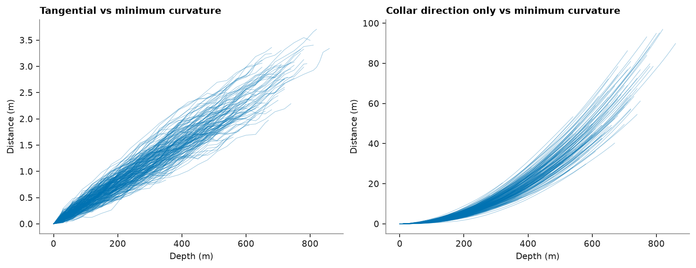
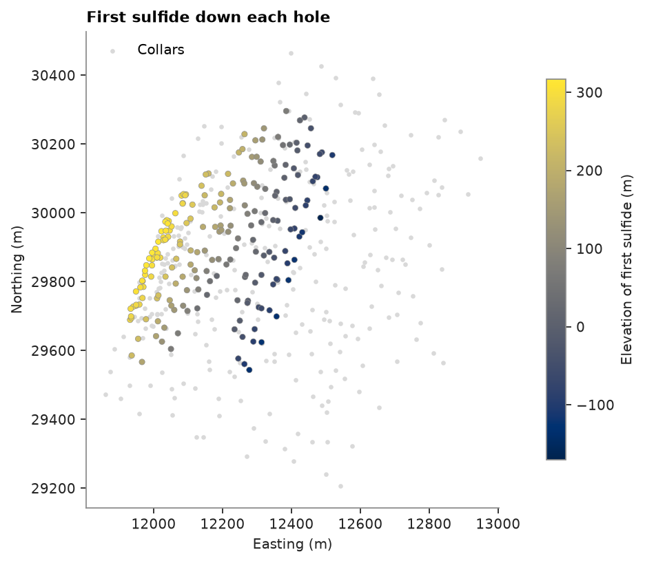

# Desurveying drill holes

The stacked sulfide lenses: 244 diamond holes up to 870 m long, which flatten and swing clockwise as they deepen,
and 45 short RC holes. Desurveying turns each collar and its survey stations (depth, dip positive down, azimuth
clockwise from north) into a path, so any depth down a hole has coordinates.

<details><summary>Python</summary>

```python
import boitata as bt
import matplotlib.pyplot as plt
import numpy as np
from common import ACCENT, GRAY, LIGHT, map_axes, save
```

</details>

`Drillholes` desurveys each hole from its collar and survey. `paths` gives the position of each survey station.
The deepest hole, `DD0217`, flattens from 48° to 36° and swings from azimuth 303° to 308° on its way down:

<details><summary>Python</summary>

```python
data = bt.datasets.stacked_sulphide_lenses()
collar, survey = data["collars"], data["surveys"]
dh = bt.Drillholes.from_tables(data, intervals=None)
paths = dh.paths()
print(dh)
last = np.flatnonzero(paths["HOLE_ID"] == "DD0217")[[0, 1, -2, -1]]
station = np.flatnonzero(survey["HOLE_ID"] == "DD0217")[[0, 1, -2, -1]]
for i, j in zip(last, station):
    print(
        f"{paths['depth'][i]:6.1f} m  dip {survey['DIP'][j]:5.2f}  azimuth {survey['AZIMUTH'][j]:6.2f}"
        f"  ->  x {paths['x'][i]:8.1f}  y {paths['y'][i]:8.1f}  z {paths['z'][i]:6.1f}"
    )
```

</details>

```text
Drillholes(289 holes, 0 intervals)
   0.0 m  dip 48.23  azimuth 302.90  ->  x  12840.6  y  29563.8  z  377.6
  30.0 m  dip 47.56  azimuth 303.12  ->  x  12823.7  y  29574.8  z  355.3
 840.0 m  dip 36.31  azimuth 308.06  ->  x  12336.3  y  29919.5  z -190.2
 869.8 m  dip 35.88  azimuth 308.08  ->  x  12317.4  y  29934.3  z -207.7
```

Between stations the path depends on the method. Minimum curvature, the default, bends along a circular arc.
Tangential holds each station's direction down to the next, and balanced tangential gives half of each segment to
each end. `at` places any depth on the path, here the end of each hole. The plot adds a hole drilled straight from
its collar direction, as if never surveyed:

<details><summary>Python</summary>

```python
holes, length = list(collar["HOLE_ID"]), collar["LENGTH"]
reference = dh.at(holes, length)
collar_station = np.cumsum(survey["DEPTH"] == 0) - 1
unsurveyed = bt.Table(
    {
        "HOLE_ID": survey["HOLE_ID"],
        "DEPTH": survey["DEPTH"],
        "DIP": survey["DIP"][survey["DEPTH"] == 0][collar_station],
        "AZIMUTH": survey["AZIMUTH"][survey["DEPTH"] == 0][collar_station],
    }
)
alternatives = {
    "tangential": bt.Drillholes(collar, survey, method="tangential"),
    "balanced_tangential": bt.Drillholes(collar, survey, method="balanced_tangential"),
    "collar direction only": bt.Drillholes(collar, unsurveyed),
}
for name, other in alternatives.items():
    shift = np.linalg.norm(other.at(holes, length) - reference, axis=1)
    print(
        f"{name:>21}: end of hole {np.median(shift):7.3f} m from minimum curvature (median), {shift.max():7.3f} m max"
    )
```

</details>

```text
           tangential: end of hole   1.651 m from minimum curvature (median),   3.749 m max
  balanced_tangential: end of hole   0.003 m from minimum curvature (median),   0.008 m max
collar direction only: end of hole  22.884 m from minimum curvature (median),  99.212 m max
```

With stations every 30 m, tangential ends at most 3.7 m from minimum curvature and balanced tangential within
about 1 cm. Ignoring the survey puts a hole's end up to 99 m away. Both gaps grow with depth:

<details><summary>Python</summary>

```python
long = collar["TYPE"] == "DD"
fig, axes = plt.subplots(1, 2, figsize=(10, 3.8), layout="constrained")
for ax, name in zip(axes, ("tangential", "collar direction only")):
    for h, total in zip(np.array(holes)[long], length[long]):
        depth = np.arange(0, total, 10.0)
        at = [h] * len(depth)
        shift = np.linalg.norm(alternatives[name].at(at, depth) - dh.at(at, depth), axis=1)
        ax.plot(depth, shift, color=ACCENT, lw=0.5, alpha=0.4)
    ax.set(title=f"{name.capitalize()} vs minimum curvature", xlabel="Depth (m)", ylabel="Distance (m)")
save(fig, "divergence")
```

</details>



`at` also places logged contacts. The top of the first sulfide (`MS`, `SMS` or `STR`) down each hole traces the
hanging wall of the upper lens, which deepens to the east-southeast:

<details><summary>Python</summary>

```python
lith = data["lithology"]
sulphide = np.isin(lith["LITH"], ["MS", "SMS", "STR"])
hole_ids = lith["HOLE_ID"][sulphide]
first = np.r_[True, hole_ids[1:] != hole_ids[:-1]]
top = dh.at(list(hole_ids[first]), lith["FROM"][sulphide][first])
print(
    f"{len(top)} holes reach sulphide, from {top[:, 2].max():.0f} m down to {top[:, 2].min():.0f} m elevation"
)

fig, ax = plt.subplots(figsize=(6, 5), layout="constrained")
ax.scatter(collar["X"], collar["Y"], s=4, color=LIGHT, label="Collars")
points = ax.scatter(top[:, 0], top[:, 1], c=top[:, 2], s=14, cmap="cividis", edgecolor=GRAY, lw=0.3)
fig.colorbar(points, ax=ax, shrink=0.8, label="Elevation of first sulfide (m)")
map_axes(ax, "First sulfide down each hole")
ax.legend(loc="upper left")
save(fig, "contacts")
```

</details>

```text
202 holes reach sulphide, from 317 m down to -171 m elevation
```



Full script: [`example_02_02.py`](example_02_02.py)
