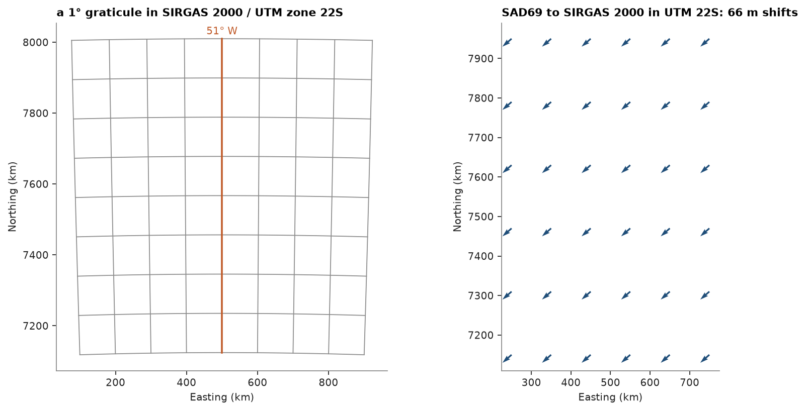

# coordinate reference systems

`to_crs` converts a `PointSet`, `Polylines`, `Mesh` or `BlockModel` to another CRS named by its EPSG code. it knows
geographic coordinates and UTM zones on WGS 84, SIRGAS 2000, SAD69, NAD83, ETRS89 and GDA2020, and changes datum
with the 7-parameter Helmert transformations EPSG publishes. heights are kept: there are no vertical datums.

<details><summary>Python</summary>

```python
import boitata as bt
import matplotlib.pyplot as plt
import numpy as np
from common import ACCENT, GRAY, HIGHLIGHT, map_axes, save
```

</details>

## geographic to UTM

a graticule every degree, in longitude and latitude on SIRGAS 2000 (`EPSG:4674`), goes to UTM zone 22S
(`EPSG:31982`). meridians converge towards the pole and bend away from the central meridian at 51° W.

<details><summary>Python</summary>

```python
t = np.linspace(0.0, 1.0, 50)
meridians = [np.column_stack([np.full_like(t, lon), -26.0 + 8.0 * t]) for lon in range(-55, -46)]
parallels = [np.column_stack([-55.0 + 8.0 * t, np.full_like(t, lat)]) for lat in range(-26, -17)]
graticule = bt.Polylines(meridians + parallels, crs="EPSG:4674")
utm = graticule.to_crs("EPSG:31982")
print(utm.crs, utm.length_unit)
print(np.round(utm.bounds[0][:2]), np.round(utm.bounds[1][:2]))
```

</details>

```text
EPSG:31982 m
[  76269. 7118181.] [ 923731. 8009814.]
```

## a change of datum

SAD69 is the older Brazilian datum. EPSG:15485 takes it to SIRGAS 2000 by a geocentric shift of
(-67.35, 3.88, -38.22) m, so the same easting and northing in SAD69 / UTM zone 22S (`EPSG:29192`) lands some 66 m
away in SIRGAS 2000 / UTM zone 22S. the round trip comes back within a fraction of a millimetre.

<details><summary>Python</summary>

```python
east, north = np.meshgrid(np.linspace(250e3, 750e3, 6), np.linspace(7.15e6, 7.95e6, 6))
old = bt.PointSet(np.column_stack([east.ravel(), north.ravel()]), crs="EPSG:29192", length_unit="m")
new = old.to_crs("EPSG:31982")
shift = new.coords - old.coords
print(
    f"shift {np.hypot(shift[:, 0], shift[:, 1]).min():.1f} to {np.hypot(shift[:, 0], shift[:, 1]).max():.1f} m"
)
back = new.to_crs("EPSG:29192")
print(f"round trip {np.abs(back.coords - old.coords).max() * 1e3:.4f} mm")
```

</details>

```text
shift 65.8 to 66.5 m
round trip 0.0784 mm
```

## block models

SIRGAS 2000 and WGS 84 are the same frame within a metre, a null transformation in EPSG, so a model in SIRGAS 2000 /
UTM zone 22S relabelled as WGS 84 / UTM zone 22S stays a block model. any change that moves the blocks off their grid
returns the centroids as a `PointSet`, attributes included.

<details><summary>Python</summary>

```python
model = bt.BlockModel(
    (500e3, 7.4e6, 0.0),
    (25.0, 25.0, 10.0),
    (4, 4, 2),
    crs="EPSG:31982",
    length_unit="m",
    attributes={"AU": np.linspace(0.0, 2.0, 32)},
)
print(type(model.to_crs("EPSG:32722")).__name__, model.to_crs("EPSG:32722").crs)
centroids = model.to_crs("EPSG:4326")
print(type(centroids).__name__, centroids.column_names, np.round(centroids.coords[0], 6))
```

</details>

```text
BlockModel EPSG:32722
PointSet ['AU'] [-50.999878 -23.510082   5.      ]
```

other CRSs raise `InvalidInput` with the supported set.

<details><summary>Python</summary>

```python
try:
    old.to_crs("EPSG:27700")
except bt.InvalidInput as error:
    print(str(error)[:80], "...")
```

</details>

```text
unsupported CRS EPSG:27700; supported are EPSG geographic 2D and UTM codes on WG ...
```

<details><summary>Python</summary>

```python
fig, (left, right) = plt.subplots(1, 2, figsize=(10, 5), layout="constrained")
for part in utm.parts:
    left.plot(part[:, 0] / 1e3, part[:, 1] / 1e3, color=GRAY, lw=0.8)
central = bt.Polylines([np.column_stack([np.full_like(t, -51.0), -26.0 + 8.0 * t])], crs="EPSG:4674")
part = central.to_crs("EPSG:31982").parts[0] / 1e3
left.plot(part[:, 0], part[:, 1], color=HIGHLIGHT, lw=1.6)
left.annotate("51° W", part[-1, :2], xytext=(0, 4), textcoords="offset points", ha="center", color=HIGHLIGHT)
map_axes(left, "a 1° graticule in SIRGAS 2000 / UTM zone 22S")
right.quiver(old.x / 1e3, old.y / 1e3, shift[:, 0], shift[:, 1], color=ACCENT, angles="xy")
map_axes(right, f"SAD69 to SIRGAS 2000 in UTM 22S: {np.hypot(*shift[:, :2].T).mean():.0f} m shifts")
for ax in (left, right):
    ax.set_xlabel("Easting (km)")
    ax.set_ylabel("Northing (km)")
save(fig, "crs")
plt.show()
```

</details>



Full script: [`example_02_27.py`](example_02_27.py)
