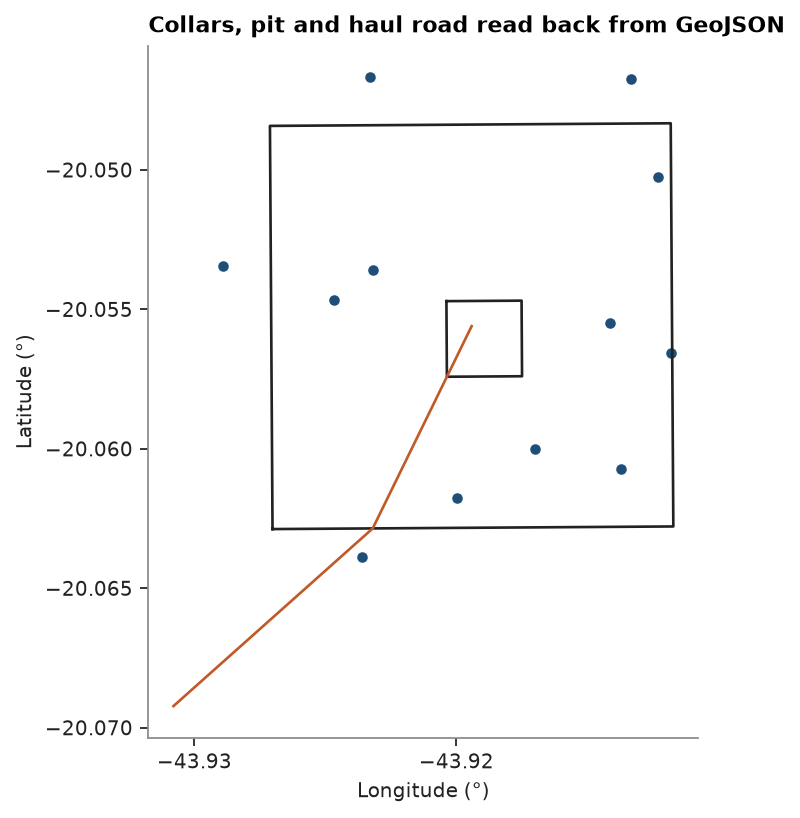

# GeoJSON

`write_geojson` writes a `PointSet` or `Polylines` as a GeoJSON feature collection, the format web maps read.
RFC 7946 wants longitude and latitude on WGS 84, so coordinates with a CRS are converted with `to_crs` on the way
out. `read_geojson` reads points, lines and polygons back with their properties as columns, z included.

<details><summary>Python</summary>

```python
import json
import tempfile

import boitata as bt
import matplotlib.pyplot as plt
import numpy as np
from common import ACCENT, HIGHLIGHT, INK, save

rng = np.random.default_rng(7)
collars = bt.PointSet(
    np.column_stack(
        [rng.uniform(612e3, 614e3, 12), rng.uniform(7.781e6, 7.783e6, 12), rng.uniform(880, 940, 12)]
    ),
    {"HOLE": [f"DH{i:03d}" for i in range(12)], "DEPTH": np.where(np.arange(12) == 3, np.nan, 150.0)},
    crs="EPSG:31983",
    length_unit="m",
)
pit = np.array([[612.2e3, 7.7812e6], [613.8e3, 7.7812e6], [613.8e3, 7.7828e6], [612.2e3, 7.7828e6]])
pond = np.array([[612.9e3, 7.7818e6], [613.2e3, 7.7818e6], [613.2e3, 7.7821e6], [612.9e3, 7.7821e6]])
road = np.array([[611.8e3, 7.7805e6, 870.0], [612.6e3, 7.7812e6, 885.0], [613.0e3, 7.7820e6, 900.0]])
outlines = bt.Polylines(
    [pit, pond, road],
    features=[0, 0, 1],
    closed=[True, True, False],
    attributes={"NAME": ["pit", "haul road"]},
    crs="EPSG:31983",
)
```

</details>

## Writing

Each point and each feature becomes a GeoJSON feature. The pit with its pond is a polygon with a hole, the road a
line string. Coordinates come out in degrees, heights in meters as they were; the null depth is JSON `null`.

<details><summary>Python</summary>

```python
folder = Path(tempfile.mkdtemp())
bt.write_geojson(folder / "collars.geojson", collars)
bt.write_geojson(folder / "outlines.geojson", outlines)
first = json.loads((folder / "collars.geojson").read_text())["features"][3]
print(json.dumps(first))
print([f["geometry"]["type"] for f in json.loads((folder / "outlines.geojson").read_text())["features"]])
```

</details>

```text
{"type": "Feature", "geometry": {"coordinates": [-43.92467883147584, -20.054670101592766, 935.0300663915712], "type": "Point"}, "properties": {"HOLE": "DH003", "DEPTH": null}}
['Polygon', 'LineString']
```

## Reading

A file without a `crs` member is in EPSG:4326. `to_crs` takes it back to UTM, within a fraction of a millimeter.

<details><summary>Python</summary>

```python
points = bt.read_geojson(folder / "collars.geojson")
print(points.crs, points.column_names)
back = points.to_crs("EPSG:31983")
print(f"largest difference {np.abs(back.coords - collars.coords).max() * 1e3:.4f} mm")
lines = bt.read_geojson(folder / "outlines.geojson")
print(lines.crs, lines.column_names, lines.closed)
```

</details>

```text
EPSG:4326 ['HOLE', 'DEPTH']
largest difference 0.0000 mm
EPSG:4326 ['NAME'] [ True  True False]
```

<details><summary>Python</summary>

```python
fig, ax = plt.subplots(figsize=(6, 5), layout="constrained")
for part, closed in zip(lines.parts, lines.closed):
    ring = np.vstack([part, part[:1]]) if closed else part
    ax.plot(ring[:, 0], ring[:, 1], color=INK if closed else HIGHLIGHT, lw=1.2)
ax.scatter(points.x, points.y, s=14, color=ACCENT)
ax.set_aspect(1 / np.cos(np.radians(points.y.mean())))
ax.locator_params(axis="x", nbins=4)
ax.set_xlabel("Longitude (°)")
ax.set_ylabel("Latitude (°)")
ax.set_title("Collars, pit and haul road read back from GeoJSON")
save(fig, "geojson")
plt.show()
```

</details>



Full script: [`example_02_28.py`](example_02_28.py)
