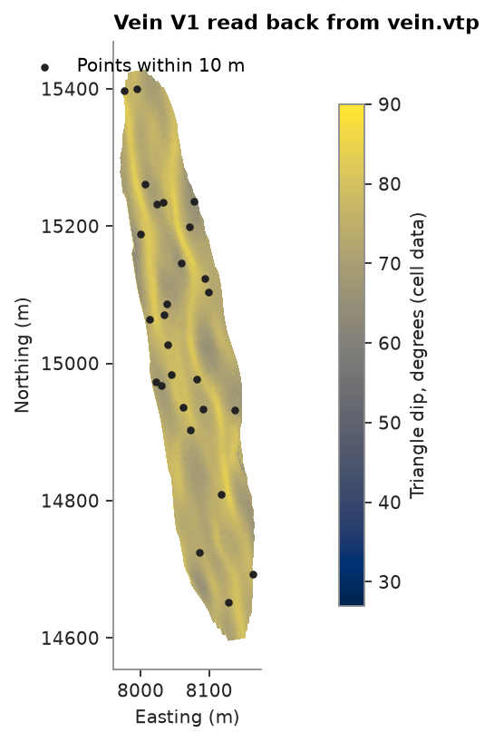
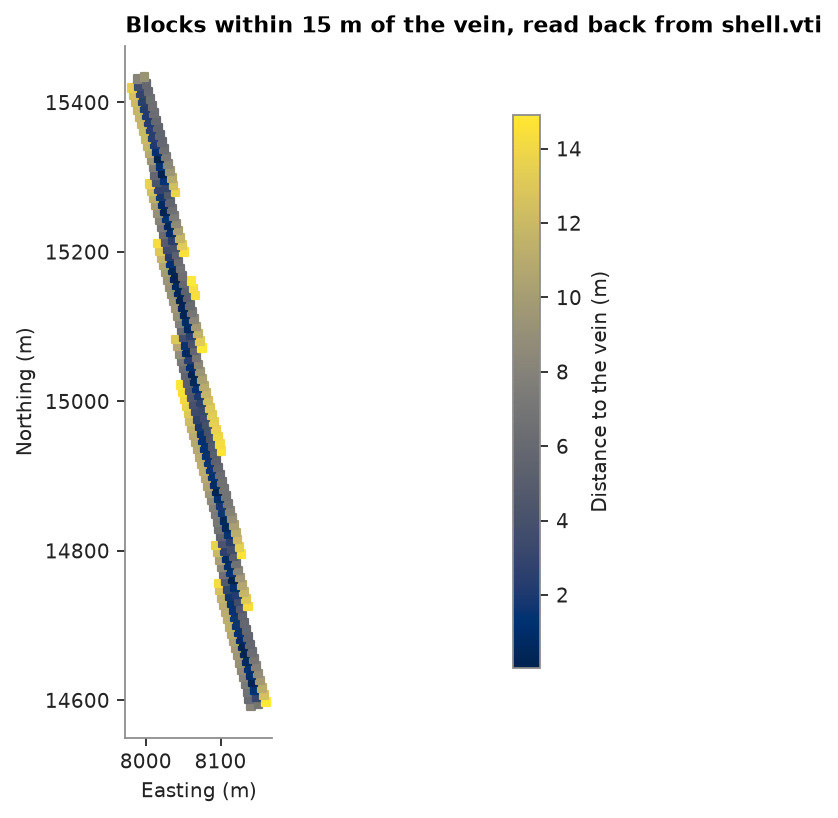

# VTK files

`write_vtk` writes a `PointSet`, `Polylines`, `Mesh` or `BlockModel` as a VTK XML file, which 3D viewers and
VTK-based tools open with their columns. `read_vtk` reads it back to the same container, whether the file is ASCII,
binary or appended, compressed or not. You write a vein of the grade-control dataset with a column per vertex and
per triangle, points around it with their distance to the vein, and the blocks near it.

<details><summary>Python</summary>

```python
import tempfile

import boitata as bt
import matplotlib.pyplot as plt
import numpy as np
from common import INK, map_axes, save

vein = bt.read_mesh(bt.datasets.fetch("mining/3d/vein-gold-grade-control/vein_V1.stl"))
elevation = vein.z.copy()
elevation[::50] = np.nan
a, b, c = vein.coords[vein.triangles].transpose(1, 0, 2)
normal = np.cross(b - a, c - a)
dip = np.degrees(np.arccos(np.abs(normal[:, 2]) / np.linalg.norm(normal, axis=1)))
vein = vein.with_vertex_column("elevation", elevation).with_face_column("dip", dip)
print(vein)

rng = np.random.default_rng(7)
(x0, y0, z0), (x1, y1, z1) = vein.bounds
coords = rng.uniform([x0, y0, z0], [x1, y1, z1], size=(300, 3))
points = bt.PointSet(coords, attributes={"distance": vein.distance(coords)})
```

</details>

```text
Mesh(26949 vertices, 53894 triangles, closed)
  elevation: Float64
  dip: Float64
```

Point and cell data become columns. VTK has no nulls, so a column with nulls is written with NaN in their place
and a `<name>_valid` array of ones and zeros, which `read_vtk` turns back into nulls. Binary files append the
arrays raw after the XML; `ascii=True` writes them as text.

<details><summary>Python</summary>

```python
folder = Path(tempfile.mkdtemp())
for file, data, options in [
    ("vein.vtp", vein, {}),
    ("vein.vtu", vein, {"ascii": True}),
    ("points.vtp", points, {}),
]:
    path = folder / file
    bt.write_vtk(path, data, **options)
    back = bt.read_vtk(path)
    same = all(np.array_equal(back[c], data[c], equal_nan=True) for c in data.column_names)
    print(f"{file:>11}: {path.stat().st_size / 1e3:6.0f} kB, {type(back).__name__}, same columns: {same}")
back = bt.read_vtk(folder / "vein.vtp")
print("nulls in elevation:", np.isnan(back["elevation"]).sum())
```

</details>

```text
   vein.vtp:   3046 kB, Mesh, same columns: True
   vein.vtu:   4170 kB, Mesh, same columns: True
 points.vtp:     15 kB, PointSet, same columns: True
nulls in elevation: 539
```

<details><summary>Python</summary>

```python
fig, ax = plt.subplots(figsize=(7, 5), layout="constrained")
image = ax.tripcolor(back.x, back.y, back.triangles, facecolors=back["dip"], cmap="cividis")
near = points["distance"] < 10
ax.scatter(points.x[near], points.y[near], s=8, color=INK, label="Points within 10 m")
fig.colorbar(image, ax=ax, shrink=0.8, label="Triangle dip, degrees (cell data)")
ax.legend(loc="upper right")
map_axes(ax, "Vein V1 read back from vein.vtp")
save(fig, "vtk")
```

</details>



## Grids

A `BlockModel` goes to `.vti` (image data): the origin, cell sizes and counts, and the rotation as the grid's
`Direction`. A masked model writes every cell and hides the absent ones with `vtkGhostType`, which viewers skip
and `read_vtk` drops again. `.vtu` holds one hexahedron per block and takes sub-blocks too; `read_vtk` rebuilds
the grid when the hexahedra are equal boxes on one lattice. `read_vtk` also reads `.vtr` and `.vts` grids,
to a `BlockModel` when their spacing is regular and to the cell centers otherwise.

Grid values stored on the nodes (point data) are not cell values: a file with point data only comes back as the
nodes, and `point_data=True` returns them from any file.

<details><summary>Python</summary>

```python
grid = bt.BlockModel.from_extents(vein, size=(10, 10, 10), buffer=20, rotation=(-15, 0, 0))
grid = grid.with_column("distance", vein.distance(grid.coords))
shell = grid.filter(grid["distance"] < 15)
print(shell)
for file in ("shell.vti", "shell.vtu"):
    bt.write_vtk(folder / file, shell)
    back = bt.read_vtk(folder / file)
    print(
        f"{file:>9}: {(folder / file).stat().st_size / 1e3:6.0f} kB, {len(back)} blocks, same: "
        f"{np.allclose(back.coords, shell.coords) and np.array_equal(back['distance'], shell['distance'])}"
    )
nodes = bt.read_vtk(folder / "shell.vti", point_data=True)
print(f"nodes of the grid: {len(nodes)}")
```

</details>

```text
BlockModel(masked, 11376 of 88000 cells, count [20, 88, 50], size [10.0, 10.0, 10.0], rotation [-15.0, 0.0, 0.0])
  distance: Float64
shell.vti:    881 kB, 11376 blocks, same: True
shell.vtu:   3107 kB, 11376 blocks, same: True
nodes of the grid: 95319
```

<details><summary>Python</summary>

```python
back = bt.read_vtk(folder / "shell.vti")
level = np.isclose(back.z, np.median(back.z))
fig, ax = plt.subplots(figsize=(7, 5), layout="constrained")
image = ax.scatter(back.x[level], back.y[level], c=back["distance"][level], s=12, marker="s", cmap="cividis")
fig.colorbar(image, ax=ax, shrink=0.8, label="Distance to the vein (m)")
map_axes(ax, "Blocks within 15 m of the vein, read back from shell.vti")
save(fig, "grid")
```

</details>



Full script: [`example_02_29.py`](example_02_29.py)
