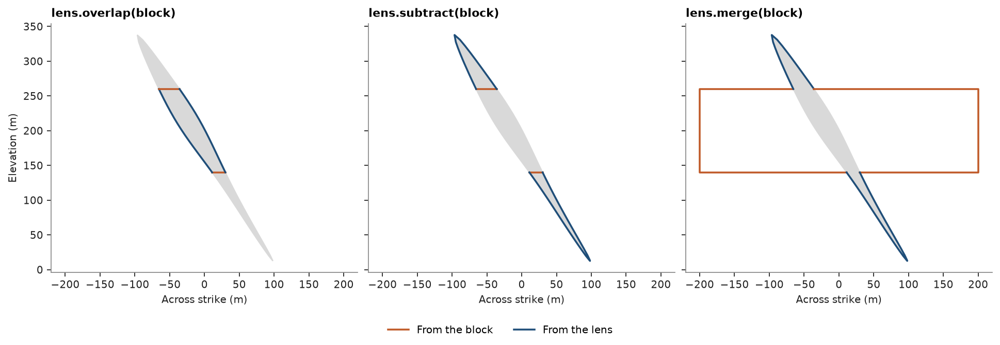

# Mesh booleans and cuts

`Mesh.merge`, `Mesh.overlap` and `Mesh.subtract` combine two closed meshes into the solid inside either, inside
both, or inside the first and outside the second. `Mesh.cut` keeps the part of a mesh behind a plane and caps it,
so a solid stays a solid. Here the first of the stacked sulfide lenses is split by a mining block and by a fault.

<details><summary>Python</summary>

```python
import boitata as bt
import matplotlib.pyplot as plt
import numpy as np
from common import ACCENT, HIGHLIGHT, LIGHT, save
```

</details>

The block is a box 200 m along strike, 400 m across and 120 m high, turned to the 23° strike of the lenses. Each
mesh gets a face column naming it, which the results carry.

<details><summary>Python</summary>

```python
data = bt.datasets.stacked_sulphide_lenses()
lens = data["lens_1"]
lens = lens.with_face_column("source", ["lens"] * len(lens.triangles))

strike = np.radians(23.0)
along = np.array([np.sin(strike), np.cos(strike), 0.0])
across = np.array([np.cos(strike), -np.sin(strike), 0.0])
(x0, y0, z0), (x1, y1, z1) = lens.bounds
center = np.array([(x0 + x1) / 2, (y0 + y1) / 2, 200.0])
unit = np.array([[x, y, z] for z in (-1, 1) for y in (-1, 1) for x in (-1, 1)], float)
corners = center + unit[:, :1] * 200 * across + unit[:, 1:2] * 100 * along + unit[:, 2:] * [0, 0, 60]
sides = np.array(
    [[0, 2, 1], [1, 2, 3], [4, 5, 6], [5, 7, 6], [0, 1, 4], [1, 5, 4],
     [2, 6, 3], [3, 6, 7], [0, 4, 2], [2, 4, 6], [1, 3, 5], [3, 7, 5]]
)  # fmt: skip
block = bt.Mesh(corners, sides).with_face_column("source", ["block"] * 12)
print(lens)
print(f"block {block.volume:,.0f} m3, wound outward: {block.volume > 0}")
```

</details>

```text
Mesh(15766 vertices, 31528 triangles, closed)
  source: Utf8
block 9,600,000 m3, wound outward: True
```

## Inside and outside the block

The triangles of both meshes that cross are split along the curve where the surfaces meet, and each piece is
kept by whether it lies inside the other mesh. The ore inside the block and the ore left outside it add back to
the lens, and the union with the block holds what neither leaves out.

<details><summary>Python</summary>

```python
inside = lens.overlap(block)
outside = lens.subtract(block)
both = lens.merge(block)
for name, part in [("lens & block", inside), ("lens - block", outside), ("lens | block", both)]:
    print(f"{name}: {part.volume:12,.0f} m3, {len(part.triangles):6,} triangles, closed: {part.is_closed}")
print(f"inside + outside - lens:        {inside.volume + outside.volume - lens.volume:+.3f} m3")
print(f"lens + block - overlap - union: {lens.volume + block.volume - inside.volume - both.volume:+.3f} m3")
```

</details>

```text
lens & block:      712,412 m3,  6,050 triangles, closed: True
lens - block:    2,075,854 m3, 28,314 triangles, closed: True
lens | block:   11,675,854 m3, 28,326 triangles, closed: True
inside + outside - lens:        +0.000 m3
lens + block - overlap - union: +0.000 m3
```

A section across strike through the block shows where each part of the outline came from: the `source` column
follows the faces, so the lines split where the lens surface meets a wall of the block.

<details><summary>Python</summary>

```python
fig, axes = plt.subplots(1, 3, figsize=(12, 4.4), layout="constrained", sharex=True, sharey=True)
colors = {"lens": ACCENT, "block": HIGHLIGHT}
outline = lens.section(center, along)
parts = {"overlap": inside, "subtract": outside, "merge": both}
for ax, (title, part) in zip(axes, parts.items(), strict=True):
    for f in range(len(outline)):
        ring = outline.parts[f] - center
        ax.fill(ring @ across, ring[:, 2] + center[2], color=LIGHT)
    lines = part.section(center, along)
    for f in range(len(lines)):
        line = lines.parts[f] - center
        if lines.closed[f]:
            line = np.r_[line, line[:1]]
        source = lines["source"][f]
        ax.plot(line @ across, line[:, 2] + center[2], color=colors[source], linewidth=1.6, label=source)
    ax.set_title(f"lens.{title}(block)")
    ax.set_aspect("equal")
    ax.set_xlabel("Across strike (m)")
axes[0].set_ylabel("Elevation (m)")
handles, labels = axes[2].get_legend_handles_labels()
unique = dict(zip(labels, handles, strict=True))
fig.legend(unique.values(), [f"From the {name}" for name in unique], loc="outside lower center", ncols=2)
save(fig, "booleans")
```

</details>



## A fault through the lens

`cut` keeps the side of the plane its normal points away from, so the normal is the outward normal of the cap. A
vertex on the plane counts as cut away, as in `section`. A fault striking 113° and dipping 60° towards 23°
splits the lens into two closed blocks whose volumes add back to the lens. The cap faces have no `source`.

<details><summary>Python</summary>

```python
dip = np.radians(60.0)
fault = np.cos(dip) * np.array([0.0, 0.0, 1.0]) + np.sin(dip) * along
hanging = lens.cut(center, -fault)
footwall = lens.cut(center, fault)
for name, part in [("footwall", footwall), ("hanging wall", hanging)]:
    cap = sum(source is None for source in part["source"])
    print(f"{name:>12}: {part.volume:10,.0f} m3, closed: {part.is_closed}, {cap} cap triangles")
print(f"{'sum - lens':>12}: {footwall.volume + hanging.volume - lens.volume:+.3f} m3")
```

</details>

```text
    footwall:  1,287,125 m3, closed: True, 474 cap triangles
hanging wall:  1,501,140 m3, closed: True, 474 cap triangles
  sum - lens: +0.000 m3
```

Full script: [`example_02_31.py`](example_02_31.py)
