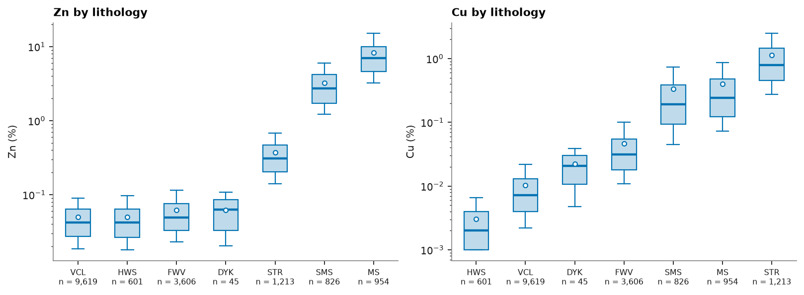
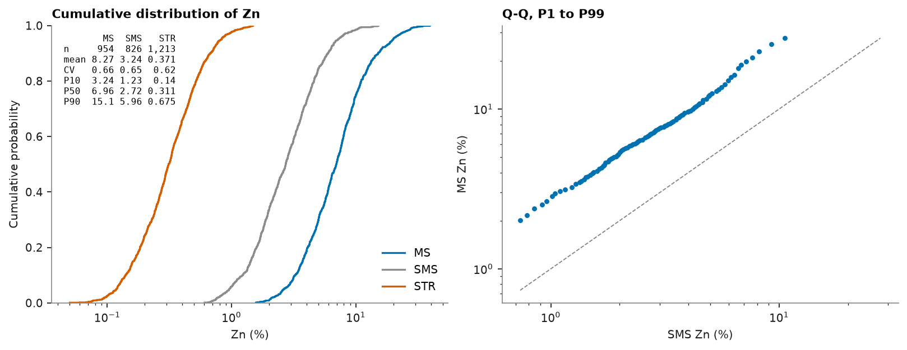

# Statistics by domain

Three stacked sulfide lenses, logged as massive (MS), semi-massive (SMS) and stringer (STR) sulfides in volcanic and
sedimentary host rocks. Do the lithologies differ enough to estimate them apart? Statistics, box plots, cumulative
distributions and Q-Q plots per lithology on 2 m composites.

<details><summary>Python</summary>

```python
import boitata as bt
import matplotlib.pyplot as plt
import numpy as np
from common import save

data = bt.datasets.stacked_sulphide_lenses()
intervals = bt.merge_intervals(data["assays"], data["lithology"])
holes = bt.Drillholes(data["collars"], data["surveys"], intervals)
composites = holes.composite(2.0, ["ZN_PCT", "CU_PCT"], domain="LITH")
print(f"{len(composites)} composites")
```

</details>

```text
16864 composites
```

`describe_by` gives the count, moments and quantiles of a column per category, then over all values on the last row.
It skips missing grades, and `weights=` takes declustering weights
([declustering](../../03-exploratory-analysis/03-declustering/README.md)).

<details><summary>Python</summary>

```python
stats = bt.describe_by("ZN_PCT", "LITH", quantiles=[0.1, 0.5, 0.9], data=composites)
print(f"{'LITH':<6}{'n':>7}{'mean':>8}{'CV':>6}{'P10':>8}{'P50':>8}{'P90':>8}{'max':>8}")
for row in zip(*(stats[c] for c in ["category", "n", "mean", "cv", "P10", "P50", "P90", "max"]), strict=True):
    print(f"{row[0]:<6}{row[1]:>7.0f}{row[2]:>8.2f}{row[3]:>6.2f}" + "".join(f"{v:>8.2f}" for v in row[4:]))
```

</details>

```text
LITH        n    mean    CV     P10     P50     P90     max
DYK        45    0.06  0.48    0.02    0.06    0.11    0.12
FWV      3606    0.06  0.71    0.02    0.05    0.12    0.39
HWS       601    0.05  0.63    0.02    0.04    0.10    0.16
MS        954    8.27  0.66    3.24    6.96   15.06   39.43
SMS       826    3.24  0.65    1.23    2.72    5.96   15.20
STR      1213    0.37  0.62    0.14    0.31    0.67    1.50
VCL      9619    0.05  0.64    0.02    0.04    0.09    0.34
all     16864    0.70  3.46    0.02    0.05    1.34   39.43
```

Mean Zn falls from 8.27 % in MS to 3.24 % in SMS and 0.37 % in STR; the host rocks and the dike hold 0.05 to 0.06 %.
Each lithology has a CV between 0.48 and 0.71, and all of them pooled reach 3.46: mixing populations makes that
spread.

Box plots show the same quantiles side by side, sorted by median. The box spans P25 to P75, the whiskers P10 to P90,
and the dot marks the mean. Cu differs from Zn: it is richest in the stringer zone below the lenses.

<details><summary>Python</summary>

```python
lith = composites["LITH"]
fig, axes = plt.subplots(1, 2, figsize=(10, 3.6), layout="constrained")
for ax, grade in zip(axes, ["ZN_PCT", "CU_PCT"], strict=True):
    bt.plot.boxplot(grade, lith, sort=True, log=True, data=composites, ax=ax)
    ax.set(title=f"{grade.split('_')[0].title()} by lithology", ylabel=f"{grade.split('_')[0].title()} (%)")
    ax.tick_params(axis="x", labelsize=7)
save(fig, "boxplot")
```

</details>



Cumulative distributions compare whole distributions; `stats=True` lists the count, mean, CV and deciles of each curve
in the corner. The Q-Q plot pairs the quantiles of two lithologies, and points along the 1:1 line would mean the same
distribution. MS against SMS falls on a line parallel to it on log axes, a constant ratio: MS is SMS scaled up about
2.6 times, the same shape at a different grade.

<details><summary>Python</summary>

```python
zn = composites["ZN_PCT"]
sulphides = ["MS", "SMS", "STR"]
fig, (a, b) = plt.subplots(1, 2, figsize=(10, 3.8), layout="constrained")
bt.plot.cdf([zn[lith == k] for k in sulphides], labels=sulphides, log=True, stats=True, ax=a)
a.set(title="Cumulative distribution of Zn", xlabel="Zn (%)")
bt.plot.qq(zn[lith == "SMS"], zn[lith == "MS"], log=True, ax=b)
b.set(title="Q-Q, P1 to P99", xlabel="SMS Zn (%)", ylabel="MS Zn (%)")
save(fig, "distributions")
ratio = np.percentile(zn[lith == "MS"], [10, 50, 90]) / np.percentile(zn[lith == "SMS"], [10, 50, 90])
print("MS over SMS at P10, P50, P90:", ", ".join(f"{r:.1f}" for r in ratio))
```

</details>

```text
MS over SMS at P10, P50, P90: 2.6, 2.6, 2.5
```



Full script: [`example_03_02.py`](example_03_02.py)
