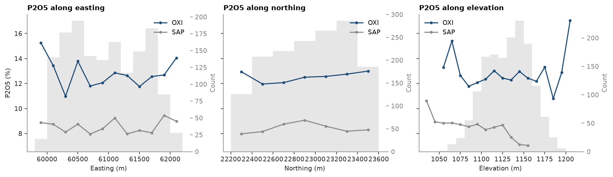

# Swaths

Phosphate concentrated by weathering, drilled by 221 RC and 30 diamond holes through soil (SOIL), an aluminous horizon
(ALU), the oxidized ore (OXI), saprolite (SAP) and fresh rock (ROCK). A swath is the mean grade in slices along one
direction. A trend in the data shows up as a slope, and the same call on a block model checks the estimate for local
bias ([model checks](../../10-checking-models/01-model-checks/README.md)).

<details><summary>Python</summary>

```python
import boitata as bt
import matplotlib.pyplot as plt
from common import save

data = bt.datasets.phosphate_weathering_profile()
intervals = bt.merge_intervals(data["assays"], data["horizons"])
samples = bt.Drillholes(data["collars"], data["surveys"], intervals).samples()
stats = bt.describe_by("P2O5_PCT", "HORIZON", data=samples)
for name, n, mean in zip(stats["category"], stats["n"], stats["mean"], strict=True):
    print(f"{name:<5}{n:>6.0f} samples, mean P2O5 {mean:5.2f} %")
length = samples["TO"] - samples["FROM"]
print(f"sample length {length.min():.1f} to {length.max():.1f} m")
```

</details>

```text
ALU    1152 samples, mean P2O5  4.74 %
OXI    1533 samples, mean P2O5 12.52 %
ROCK   1407 samples, mean P2O5  5.03 %
SAP    1241 samples, mean P2O5  8.48 %
SOIL    259 samples, mean P2O5  1.95 %
all    5592 samples, mean P2O5  7.65 %
sample length 2.2 to 5.0 m
```

The ore is the OXI horizon, with SAP below it half as rich. `swath` bins the samples in slices of a given width along
`axis` ("x", "y", "z") or any `azimuth`, weighted here by sample length since the samples run from 2.2 to 5.0 m.
`plot.swath` draws several swaths on one axis, with the counts of the first as bars. The slices are 200 m along
easting and northing and 10 m in elevation, one line per horizon.

<details><summary>Python</summary>

```python
horizons = ["OXI", "SAP"]
fig, axes = plt.subplots(1, 3, figsize=(12, 3.4), layout="constrained", sharey=True)
for ax, axis, width, label in zip(
    axes, "xyz", [200.0, 200.0, 10.0], ["Easting", "Northing", "Elevation"], strict=True
):
    swaths = []
    for name in horizons:
        horizon = samples.filter(samples["HORIZON"] == name)
        length = horizon["TO"] - horizon["FROM"]
        swaths.append(bt.swath(horizon, "P2O5_PCT", width, axis=axis, weights=length))
    bt.plot.swath(swaths, labels=horizons, ax=ax)
    ax.set(title=f"P2O5 along {label.lower()}", xlabel=f"{label} (m)")
    ax.set_ylabel("")
    for name, swath in zip(horizons, swaths, strict=True):
        mean = swath["mean"][swath["n"] >= 30]
        print(
            f"{name} along {label.lower()}: {mean.min():.1f} to {mean.max():.1f} %, slices of 30 samples or more"
        )
axes[0].set_ylabel("P2O5 (%)")
save(fig, "swaths")
```

</details>

```text
OXI along easting: 11.0 to 13.8 %, slices of 30 samples or more
SAP along easting: 8.0 to 9.4 %, slices of 30 samples or more
OXI along northing: 12.0 to 13.0 %, slices of 30 samples or more
SAP along northing: 8.0 to 9.1 %, slices of 30 samples or more
OXI along elevation: 11.8 to 13.3 %, slices of 30 samples or more
SAP along elevation: 7.1 to 8.8 %, slices of 30 samples or more
```



Within each horizon the swaths are flat. OXI stays between 11.0 and 13.8 % along easting and northing and SAP between
8.0 and 9.4 %, about the noise that a hundred-odd samples per slice leave. The step between the two lines is much
larger than any slope along them, so the horizon sets the grade: estimate each horizon on its own samples, with no
trend. In elevation the lines are noisier because the horizons follow the rolling topography, and one slice of
elevation cuts OXI on a hill and SAP in a valley. The slices at the ends hold few samples, and the bars tell you how
far to trust them.

Full script: [`example_03_09.py`](example_03_09.py)
