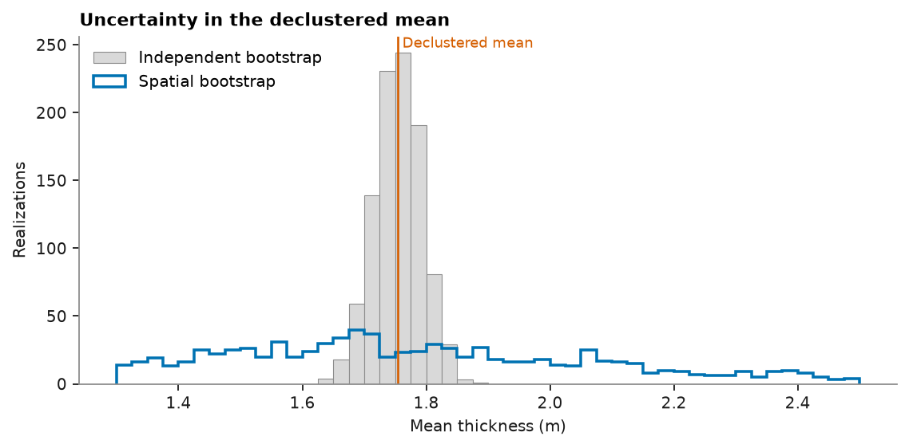
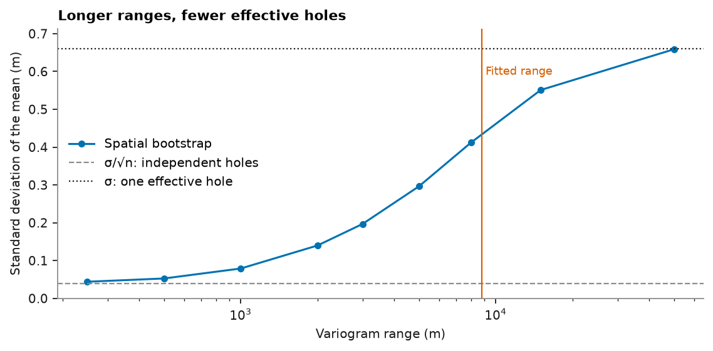

# Spatial bootstrap

A declustered mean is one number from a few hundred holes. How far off could it be? The classical bootstrap resamples
the holes independently and answers σ/√n, but neighboring holes carry much the same information, so the true
uncertainty is larger. `bt.spatial_bootstrap` resamples with the spatial correlation. Each realization draws
unconditional Gaussian values at the holes with the normal-score variogram, turns them into ranks, and reads the ranks
through the declustered distribution of the data. Nearby holes then get similar draws, and the resampled mean spreads
as far as the correlation allows.

<details><summary>Python</summary>

```python
import boitata as bt
import matplotlib.pyplot as plt
import numpy as np
from common import ACCENT, GRAY, HIGHLIGHT, INK, LIGHT, save

data = bt.datasets.coal_seam_thickness()
holes, grid = data["boreholes"], data["grid"]
thickness = holes["THICKNESS_M"]
xy = holes.coords[:, :2]
weights = bt.cell_declustering(holes, "THICKNESS_M", sizes=np.arange(100.0, 3100.0, 100.0)).weights
stats = bt.describe(thickness, weights=weights)
mean, sd = stats["mean"], stats["std"]
print(f"{len(holes)} holes, declustered mean {mean:.2f} m, standard deviation {sd:.2f} m")
```

</details>

```text
295 holes, declustered mean 1.75 m, standard deviation 0.66 m
```

The resampling runs on the variogram of the normal scores. Thicknesses are logged to the centimeter and many repeat,
so `bt.despike` breaks the ties first; the fitted variogram is then rescaled to a unit sill.

<details><summary>Python</summary>

```python
untied = bt.despike(holes, "THICKNESS_M", seed=0)
scores = bt.NormalScore().fit_transform(untied, weights=weights)
fitted = bt.Variogram.fit(bt.experimental_variogram(xy, scores, 250.0, 6000.0), "spherical")
structure = fitted.structures[0]
variogram = fitted.standardized()
print(variogram)

nugget = bt.Variogram([], nugget=1.0)
independent = bt.spatial_bootstrap(holes, "THICKNESS_M", nugget, weights=weights, n=1000)
spatial = bt.spatial_bootstrap(holes, "THICKNESS_M", variogram, weights=weights, n=1000)
for name, table in (("independent", independent), ("spatial", spatial)):
    print(f"{name:>11}: standard deviation of the mean {np.std(table['mean']):.3f} m")
print(f"        σ/√n: {sd / np.sqrt(len(holes)):.3f} m")
```

</details>

```text
Variogram  sill 1, 1 structure
  structure    sill   range
  nugget     0.1976
  spherical  0.8024  8812.5
independent: standard deviation of the mean 0.039 m
    spatial: standard deviation of the mean 0.379 m
        σ/√n: 0.038 m
```

A pure-nugget variogram makes every draw independent, which gives the classical bootstrap: its spread matches σ/√n.
With the fitted variogram, whose range is about 9 km over an 11 × 7 km lease, the spread is ten times wider:

<details><summary>Python</summary>

```python
bins = np.linspace(1.3, 2.5, 49)
fig, ax = plt.subplots(figsize=(7, 3.4), layout="constrained")
ax.hist(independent["mean"], bins, color=LIGHT, edgecolor=GRAY, lw=0.5, label="Independent bootstrap")
ax.hist(spatial["mean"], bins, histtype="step", color=ACCENT, lw=1.6, label="Spatial bootstrap")
ax.axvline(mean, color=HIGHLIGHT, lw=1.2)
ax.text(mean, ax.get_ylim()[1], " Declustered mean", color=HIGHLIGHT, va="top", fontsize=8)
ax.set(xlabel="Mean thickness (m)", ylabel="Realizations", title="Uncertainty in the declustered mean")
ax.legend(loc="upper left")
save(fig, "means")
```

</details>



## Range and effective number of holes

The spread grows with the range. As an effective number of independent holes, (σ / spread)², the 295 holes count as
about three at the fitted range of 9 km, and as one once the range spans the whole lease.

<details><summary>Python</summary>

```python
ranges = np.array([250.0, 500.0, 1000.0, 2000.0, 3000.0, 5000.0, 8000.0, 15000.0, 50000.0])
spreads = np.array(
    [
        np.std(
            bt.spatial_bootstrap(
                holes, "THICKNESS_M", bt.Variogram([("spherical", 1.0, r)]), weights=weights, n=400
            )["mean"]
        )
        for r in ranges
    ]
)
for r, s in zip(ranges, spreads):
    print(f"range {r:>7.0f} m: spread {s:.3f} m, effective holes {(sd / s) ** 2:.0f}")

fig, ax = plt.subplots(figsize=(7, 3.4), layout="constrained")
ax.semilogx(ranges, spreads, "o-", color=ACCENT, lw=1.4, ms=4, label="Spatial bootstrap")
ax.axhline(sd / np.sqrt(len(holes)), color=GRAY, ls="--", lw=1, label="σ/√n: independent holes")
ax.axhline(sd, color=INK, ls=":", lw=1, label="σ: one effective hole")
ax.axvline(structure.range, color=HIGHLIGHT, lw=1)
ax.text(structure.range, sd * 0.93, " Fitted range", color=HIGHLIGHT, va="top", fontsize=8)
ax.set(
    xlabel="Variogram range (m)",
    ylabel="Standard deviation of the mean (m)",
    title="Longer ranges, fewer effective holes",
    ylim=(0, sd * 1.08),
)
ax.legend(loc="center left")
save(fig, "ranges")
```

</details>

```text
range     250 m: spread 0.044 m, effective holes 225
range     500 m: spread 0.053 m, effective holes 157
range    1000 m: spread 0.079 m, effective holes 70
range    2000 m: spread 0.140 m, effective holes 22
range    3000 m: spread 0.197 m, effective holes 11
range    5000 m: spread 0.296 m, effective holes 5
range    8000 m: spread 0.412 m, effective holes 3
range   15000 m: spread 0.551 m, effective holes 1
range   50000 m: spread 0.659 m, effective holes 1
```



## Tonnage uncertainty

The lease covers the cells flagged `INSIDE`; at 1.4 t/m³ each realization of the mean thickness gives a tonnage. The
table also returns quantiles and proportions above cutoffs per realization, here the share of the seam thicker than 2
m, the minimum mining height.

<details><summary>Python</summary>

```python
area = np.sum(grid["INSIDE"] == 1) * 100.0 * 100.0
density = 1.4
for name, v in (("independent", nugget), ("spatial", variogram)):
    table = bt.spatial_bootstrap(holes, "THICKNESS_M", v, weights=weights, n=1000, cutoffs=[2.0])
    tonnes = table["mean"] * area * density / 1e6
    p10, p50, p90 = np.quantile(tonnes, [0.1, 0.5, 0.9])
    above = np.quantile(table["above 2"], [0.1, 0.9])
    print(
        f"{name:>11}: P10 {p10:.0f} Mt, P50 {p50:.0f} Mt, P90 {p90:.0f} Mt;"
        f" thicker than 2 m {above[0]:.0%} to {above[1]:.0%}"
    )
```

</details>

```text
independent: P10 172 Mt, P50 177 Mt, P90 182 Mt; thicker than 2 m 32% to 39%
    spatial: P10 128 Mt, P50 172 Mt, P90 227 Mt; thicker than 2 m 8% to 66%
```

Independent resampling promises the tonnage within a few percent; with the spatial correlation the P10 to P90 range is
ten times wider. That range is the uncertainty in the global mean from the holes alone, before any estimate or
simulation. It sets a lower bound on what a resource can claim and tells you whether more holes would pay.

Full script: [`example_03_12.py`](example_03_12.py)
