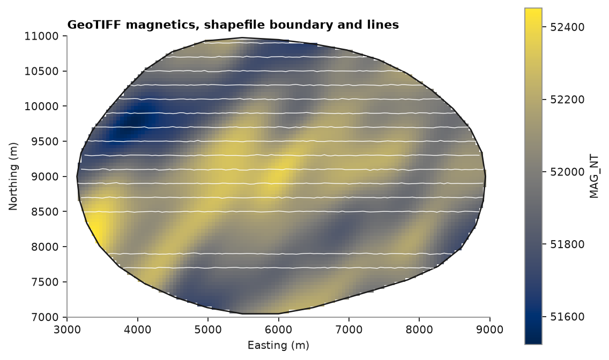
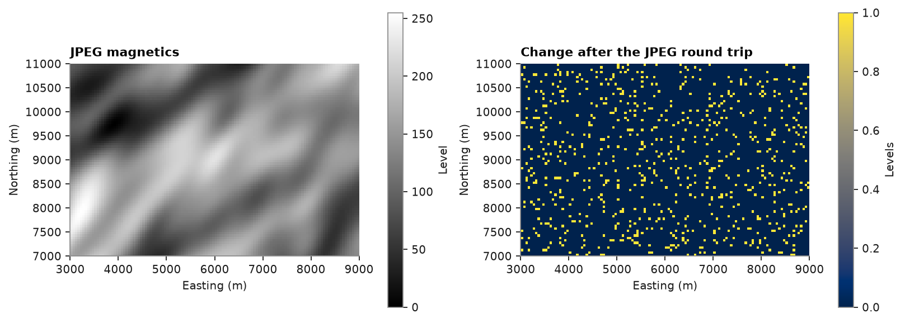
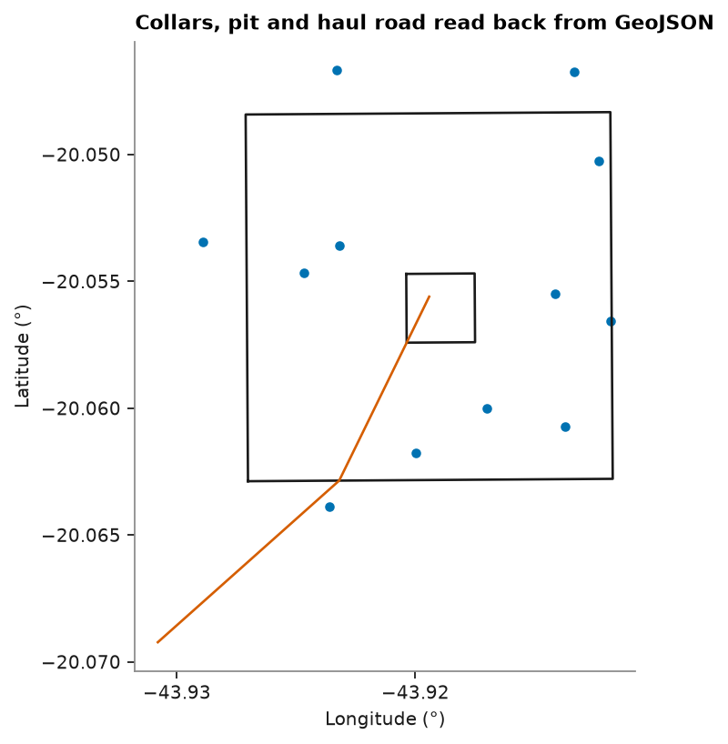

# Shapefiles, GeoPackage, GeoTIFF, JPEG and GeoJSON

GIS software exchanges points, lines and polygons as shapefiles, GeoPackages or GeoJSON, and rasters as GeoTIFF or
georeferenced JPEG.
`write_shapefile`, `write_geopackage` and `write_geotiff` write a `PointSet`, `Polylines` or 2D `BlockModel` with
its CRS, and `write_geojson` writes a `PointSet` or `Polylines`. The readers return the same container.

<details><summary>Python</summary>

```python
import json
import tempfile

import boitata as bt
import matplotlib.pyplot as plt
import numpy as np
from common import ACCENT, HIGHLIGHT, INK, map_axes, save

data = bt.datasets.soil_geochemistry_survey()
samples, boundary, covariates = data["samples"], data["boundary"], data["covariates"]
print(samples)
print(boundary)
print(covariates)
```

</details>

```text
PointSet  1,227 points
  bounds  x 3154.6 to 8900.1, y 7692 to 10905.3, z 0 to 0
  column  type     unit  nulls  min    mean   max
  ID      float64            0    1     614  1227
  CU_PPM  float64            0   10   58.61   300
  ZN_PPM  float64          363   16   77.95   340
  AU_PPB  float64            0    2   5.911    77
  AS_PPM  float64            0    5   11.29    76
  AU_BDL  float64            0    0  0.3659     1
  AS_BDL  float64            0    0  0.2698     1
Polylines  1 feature, 1 part
  closed  1 of 1 part
  bounds  x 3137.7 to 8937.7, y 7044.8 to 10974.3, z 0 to 0
BlockModel  regular, 9,600 blocks
  count   120 × 80 × 1
  size    50 × 50 × 1
  origin  3000, 7000, 0
  bounds  x 3000 to 9000, y 7000 to 11000, z 0 to 1
  column       type     unit  nulls    min     mean    max
  ELEVATION_M  float64            0  272.5    417.9  578.5
  MAG_NT       float64            0  51522  52013.4  52476
  LITHOLOGY    str                0  4 unique: GRANITE, FELSIC_VOLCANIC, MAFIC_VOLCANIC, …
  INSIDE       float64            0      0   0.7368      1
```

## Shapefiles

`write_shapefile` stores the coordinates, the attributes (names of at most 10 characters) and, when the container
has one, the CRS in a `.prj`. Points and polylines go to separate files. The format wants outer rings clockwise, so
the counter-clockwise boundary comes back with its vertices in reverse order.

<details><summary>Python</summary>

```python
folder = Path(tempfile.mkdtemp())
bt.write_shapefile(folder / "samples.shp", samples)
bt.write_shapefile(folder / "boundary.shp", boundary)
print(sorted(p.name for p in folder.glob("samples.*")))
points, outline = bt.read_shapefile(folder / "samples.shp"), bt.read_shapefile(folder / "boundary.shp")
print("same points:", np.array_equal(points.coords, samples.coords))
print(
    "same boundary, reversed:",
    np.array_equal(outline.coords, boundary.coords[::-1]),
    "| closed:",
    outline.closed,
)
```

</details>

```text
['samples.cpg', 'samples.dbf', 'samples.shp', 'samples.shx']
same points: True
same boundary, reversed: True | closed: [ True]
```

A `Polylines` feature is made of parts. A closed part is a ring whose last vertex joins the first, and a ring inside
another ring of the same feature is a hole. Open parts are lines: the samples lie on east-west survey lines about
200 m apart, and each line, joined sample to sample, goes to a line shapefile.

<details><summary>Python</summary>

```python
north = np.round(samples.y, -2)
rows = [samples.coords[north == y][np.argsort(samples.x[north == y]), :2] for y in np.unique(north)]
survey = bt.Polylines(rows, attributes={"NORTHING": np.unique(north)})
bt.write_shapefile(folder / "lines.shp", survey)
lines = bt.read_shapefile(folder / "lines.shp")
print(lines)
```

</details>

```text
Polylines  15 features, 15 parts
  closed  0 of 15 parts
  bounds  x 3154.6 to 8900.1, y 7692 to 10905.3, z 0 to 0
  column    type     unit  nulls   min    mean    max
  NORTHING  float64            0  7700  9446.7  10900
```

## GeoPackage

A GeoPackage is a single SQLite file holding many layers, with attribute names of any length and the CRS as an EPSG
code or WKT. `write_geopackage` adds a layer, or replaces the one of the same name. `read_geopackage` needs `layer=`
when the file holds more than one. Python's own `sqlite3` reads and writes the tables.

<details><summary>Python</summary>

```python
package = folder / "survey.gpkg"
bt.write_geopackage(package, samples, layer="samples")
bt.write_geopackage(package, boundary, layer="boundary")
bt.write_geopackage(package, survey, layer="lines")
points = bt.read_geopackage(package, layer="samples")
print(points)
print("same points:", np.array_equal(points.coords, samples.coords), "| CRS:", points.crs)
print(
    "same boundary area:", np.allclose(bt.read_geopackage(package, layer="boundary").area(), boundary.area())
)
```

</details>

```text
PointSet  1,227 points
  bounds  x 3154.6 to 8900.1, y 7692 to 10905.3, z 0 to 0
  column  type     unit  nulls  min    mean   max
  ID      float64            0    1     614  1227
  CU_PPM  float64            0   10   58.61   300
  ZN_PPM  float64          363   16   77.95   340
  AU_PPB  float64            0    2   5.911    77
  AS_PPM  float64            0    5   11.29    76
  AU_BDL  float64            0    0  0.3659     1
  AS_BDL  float64            0    0  0.2698     1
same points: True | CRS: None
same boundary area: True
```

## GeoTIFF

`write_geotiff` writes each column of a 2D grid as a band, nulls as the `nodata` value and the CRS in the
geokeys, so GIS software opens it as a georeferenced raster. It handles rotated grids, and writes a masked model
with nodata in its absent cells: here only the cells inside the survey area remain. Bands hold numbers, so the
lithology names go in as the codes of a `Categories` scheme.

<details><summary>Python</summary>

```python
scheme = bt.Categories.from_values(covariates["LITHOLOGY"])
numeric = bt.BlockModel(
    covariates.origin,
    covariates.size,
    covariates.count,
    attributes={
        "ELEVATION_M": covariates["ELEVATION_M"],
        "MAG_NT": covariates["MAG_NT"],
        "LITHOLOGY": scheme.encode(covariates["LITHOLOGY"]),
    },
)
inside = numeric.filter(covariates["INSIDE"] == 1)
bt.write_geotiff(folder / "covariates.tif", inside)
raster = bt.read_geotiff(folder / "covariates.tif")
print(raster)
print(f"{(folder / 'covariates.tif').stat().st_size / 1e6:.2f} MB")
magnetics = raster["MAG_NT"]
present = np.isfinite(magnetics)
print(
    f"same origin: {raster.origin == covariates.origin} | cells with data: {present.sum()} of {len(magnetics)}"
)
for name, n in zip(scheme.names, np.bincount(raster["LITHOLOGY"][present].astype(int))):
    print(f"{name:>16}: {n} cells")
```

</details>

```text
BlockModel  regular, 9,600 blocks
  count   120 × 80 × 1
  size    50 × 50 × 1
  origin  3000, 7000, 0
  bounds  x 3000 to 9000, y 7000 to 11000, z 0 to 1
  column       type     unit  nulls    min     mean    max
  ELEVATION_M  float64        2,527  278.1    416.4  529.1
  MAG_NT       float64        2,527  51522  52027.2  52452
  LITHOLOGY    float64        2,527      0    2.042      3
0.04 MB
same origin: True | cells with data: 7073 of 9600
 FELSIC_VOLCANIC: 1042 cells
         GRANITE: 391 cells
  MAFIC_VOLCANIC: 2871 cells
    METASEDIMENT: 2769 cells
```

The raster comes back as a regular grid: the 2527 cells outside the survey area are null in every band.

<details><summary>Python</summary>

```python
(x0, y0, _), (x1, y1, _) = raster.bounds
fig, ax = plt.subplots(figsize=(7, 5), layout="constrained")
image = ax.imshow(raster.grid("MAG_NT")[0], origin="lower", extent=(x0, x1, y0, y1), cmap="cividis")
for part in outline.parts:
    ring = np.vstack([part, part[:1]])
    ax.plot(ring[:, 0], ring[:, 1], color=INK, lw=1.2)
for part in lines.parts:
    ax.plot(part[:, 0], part[:, 1], color="white", lw=0.6)
fig.colorbar(image, ax=ax, shrink=0.8, label="MAG_NT")
map_axes(ax, "GeoTIFF magnetics, shapefile boundary and lines")
save(fig, "gis")
```

</details>



## JPEG

A georeferenced JPEG is an 8-bit image with a `.jgw` world file (pixel size, rotation and the center of the
top-left pixel) and an `.aux.xml` sidecar holding the CRS. `write_jpeg` takes one column (gray) or three (red,
green, blue) of whole numbers from 0 to 255 with no nulls, so the magnetics are scaled to that range first. JPEG is
lossy: even at `quality=100` some levels change. `read_jpeg` names the bands `band_1`, `band_2`, ...

<details><summary>Python</summary>

```python
mag = covariates["MAG_NT"]
gray = bt.BlockModel(
    covariates.origin,
    covariates.size,
    covariates.count,
    attributes={"MAG": np.round(255 * (mag - mag.min()) / (mag.max() - mag.min()))},
    crs="local survey grid",
)
bt.write_jpeg(folder / "magnetics.jpg", gray, quality=100)
photo = bt.read_jpeg(folder / "magnetics.jpg")
print(photo)
print(sorted(p.name for p in folder.glob("magnetics.*")))
error = np.abs(photo["band_1"] - gray["MAG"])
print(
    f"same origin: {photo.origin == gray.origin} | CRS: {photo.crs} | largest change: {error.max():.0f} levels"
)
```

</details>

```text
BlockModel  regular, 9,600 blocks
  count   120 × 80 × 1
  size    50 × 50 × 1
  origin  3000, 7000, 0
  crs     local survey grid
  bounds  x 3000 to 9000, y 7000 to 11000, z 0 to 1
  column  type     unit  nulls  min   mean  max
  band_1  float64            0    0  131.3  255
['magnetics.jgw', 'magnetics.jpg', 'magnetics.jpg.aux.xml']
same origin: True | CRS: local survey grid | largest change: 1 levels
```

<details><summary>Python</summary>

```python
fig, (left, right) = plt.subplots(1, 2, figsize=(10, 4.2), layout="constrained")
image = left.imshow(photo.grid("band_1")[0], origin="lower", extent=(x0, x1, y0, y1), cmap="gray")
fig.colorbar(image, ax=left, shrink=0.8, label="Level")
map_axes(left, "JPEG magnetics")
change = np.abs(photo.grid("band_1")[0] - gray.grid("MAG")[0])
image = right.imshow(change, origin="lower", extent=(x0, x1, y0, y1), cmap="cividis")
fig.colorbar(image, ax=right, shrink=0.8, label="Levels")
map_axes(right, "Change after the JPEG round trip")
save(fig, "jpeg")
```

</details>



## GeoJSON

`write_geojson` writes a `PointSet` or `Polylines` as a GeoJSON feature collection, the format web maps read.
RFC 7946 wants longitude and latitude on WGS 84, so coordinates with a CRS are converted with `to_crs` on the way
out. `read_geojson` reads points, lines and polygons back with their properties as columns, z included.

Twelve collars and a pit outline, in UTM, stand in for a lease a web map would show.

<details><summary>Python</summary>

```python
rng = np.random.default_rng(7)
collars = bt.PointSet(
    np.column_stack(
        [rng.uniform(612e3, 614e3, 12), rng.uniform(7.781e6, 7.783e6, 12), rng.uniform(880, 940, 12)]
    ),
    {"HOLE": [f"DH{i:03d}" for i in range(12)], "DEPTH": np.where(np.arange(12) == 3, np.nan, 150.0)},
    crs="EPSG:31983",
    length_unit="m",
)
pit = np.array([[612.2e3, 7.7812e6], [613.8e3, 7.7812e6], [613.8e3, 7.7828e6], [612.2e3, 7.7828e6]])
pond = np.array([[612.9e3, 7.7818e6], [613.2e3, 7.7818e6], [613.2e3, 7.7821e6], [612.9e3, 7.7821e6]])
road = np.array([[611.8e3, 7.7805e6, 870.0], [612.6e3, 7.7812e6, 885.0], [613.0e3, 7.7820e6, 900.0]])
outlines = bt.Polylines(
    [pit, pond, road],
    features=[0, 0, 1],
    closed=[True, True, False],
    attributes={"NAME": ["pit", "haul road"]},
    crs="EPSG:31983",
)
```

</details>

Each point and each feature becomes a GeoJSON feature. The pit with its pond is a polygon with a hole, the road a
line string. Coordinates come out in degrees, heights in meters as they were; the null depth is JSON `null`.

<details><summary>Python</summary>

```python
bt.write_geojson(folder / "collars.geojson", collars)
bt.write_geojson(folder / "outlines.geojson", outlines)
first = json.loads((folder / "collars.geojson").read_text())["features"][3]
print(json.dumps(first))
print([f["geometry"]["type"] for f in json.loads((folder / "outlines.geojson").read_text())["features"]])
```

</details>

```text
{"type": "Feature", "geometry": {"coordinates": [-43.92467883147584, -20.054670101592766, 935.0300663915712], "type": "Point"}, "properties": {"HOLE": "DH003", "DEPTH": null}}
['Polygon', 'LineString']
```

A file without a `crs` member is in EPSG:4326. `to_crs` takes it back to UTM, within a fraction of a millimeter.

<details><summary>Python</summary>

```python
points = bt.read_geojson(folder / "collars.geojson")
print(points.crs, points.column_names)
back = points.to_crs("EPSG:31983")
print(f"largest difference {np.abs(back.coords - collars.coords).max() * 1e3:.4f} mm")
lines = bt.read_geojson(folder / "outlines.geojson")
print(lines.crs, lines.column_names, lines.closed)
```

</details>

```text
EPSG:4326 ['HOLE', 'DEPTH']
largest difference 0.0000 mm
EPSG:4326 ['NAME'] [ True  True False]
```

<details><summary>Python</summary>

```python
fig, ax = plt.subplots(figsize=(6, 5), layout="constrained")
for part, closed in zip(lines.parts, lines.closed):
    ring = np.vstack([part, part[:1]]) if closed else part
    ax.plot(ring[:, 0], ring[:, 1], color=INK if closed else HIGHLIGHT, lw=1.2)
ax.scatter(points.x, points.y, s=14, color=ACCENT)
ax.set_aspect(1 / np.cos(np.radians(points.y.mean())))
ax.locator_params(axis="x", nbins=4)
ax.set_xlabel("Longitude (°)")
ax.set_ylabel("Latitude (°)")
ax.set_title("Collars, pit and haul road read back from GeoJSON")
save(fig, "geojson")
plt.show()
```

</details>



Full script: [`example_03_14.py`](example_03_14.py)
