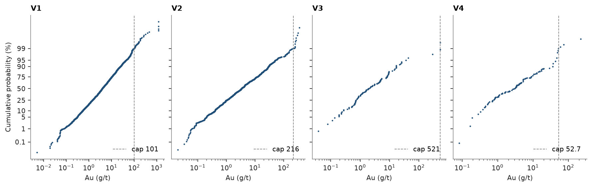
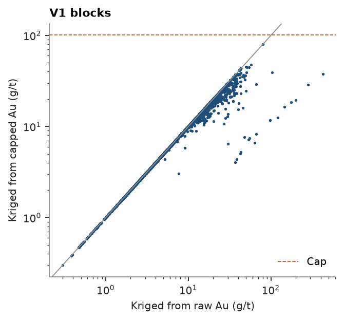

# Capping transform

`Capping` makes the top cut a pipeline step: `fit` chooses a cap per domain from the data, `transform` clips values to
it, and the fitted caps travel with the object to new data, to JSON and to pickle. You either give the cap or let a
rule choose it: a weighted quantile, a target fraction of metal removed, or a target coefficient of variation.

<details><summary>Python</summary>

```python
import boitata as bt
import matplotlib.pyplot as plt
import numpy as np
from common import ACCENT, GRAY, HIGHLIGHT, save
```

</details>

The quartz-vein composites of [top cuts](../../03-exploratory-analysis/05-top-cuts/README.md): gold in four veins, V1
to V4, sampled by diamond holes and underground channels, composited to 1 m and declustered in 20 m cells.

<details><summary>Python</summary>

```python
data = bt.datasets.vein_gold_grade_control()
intervals = bt.merge_intervals(data["assays"], data["lithology"])
holes = bt.Drillholes(data["collars"], data["surveys"], intervals)
composites = holes.composite(1.0, ["AU_GPT"], domain="LITH", categories=["VEIN"])
quartz = composites.filter(composites["LITH"] == "QV").drop_null("AU_GPT")
weights = bt.cell_declustering(quartz, "AU_GPT", cell_size=20.0).weights
quartz = quartz.with_column("w", weights)
veins = sorted(set(quartz["VEIN"]))
print(f"{len(quartz)} composites in {len(veins)} veins")
```

</details>

```text
6749 composites in 4 veins
```

## One cap per vein

Each rule fits per vein on the declustered composites. The quantile rule caps at the declustered P99, the metal rule
finds the cap that removes 5 % of the metal of each vein, and the CV rule finds the largest cap whose capped
coefficient of variation is 1.5. `caps_` and `metal_removed_` are dicts by vein.

<details><summary>Python</summary>

```python
rules = {
    "P99": bt.Capping(quantile=0.99),
    "5 % metal": bt.Capping(metal_removed=0.05),
    "CV 1.5": bt.Capping(cv=1.5),
}
for rule in rules.values():
    rule.fit("AU_GPT", domain_column="VEIN", weights="w", data=quartz)
print(f"{'vein':<6}" + "".join(f"{name:>11}{'metal (%)':>11}" for name in rules))
for vein in veins:
    row = "".join(f"{r.caps_[vein]:>11.1f}{100 * r.metal_removed_[vein]:>11.2f}" for r in rules.values())
    print(f"{vein:<6}{row}")
```

</details>

```text
vein          P99  metal (%)  5 % metal  metal (%)     CV 1.5  metal (%)
V1          100.7       9.10      202.3       5.00       63.2      14.89
V2          215.8       3.09      190.8       5.00       59.4      27.80
V3          521.0       0.00      466.1       5.00       36.3      64.84
V4           52.7       8.25      109.1       5.00       39.2      13.81
```

The rules disagree most where the tail is longest. V1 and V2 lose 9 and 3 % of their metal at the P99; holding the
loss to 5 % lifts their caps to 202 and 191 g/t, the latter just under the extreme channels of V2. In the small veins
the P99 barely cuts: it is the maximum of V3. A CV of 1.5 caps V1 and V2 near 60 g/t and costs them 15 to 28 % of
their metal.

## The same numbers as [top cuts](../../03-exploratory-analysis/05-top-cuts/README.md)

[Top cuts](../../03-exploratory-analysis/05-top-cuts/README.md) read the declustered P99 of each vein off
`describe_by` and passed it to `capping_report`. The quantile rule fits the same caps, and its `metal_removed_` is the
`1 - mean_capped / mean` of the report.

<details><summary>Python</summary>

```python
capping = rules["P99"]
stats = bt.describe_by("AU_GPT", "VEIN", weights="w", quantiles=[0.99], data=quartz)
top = dict(zip(stats["category"][:-1], stats["P99"][:-1], strict=True))
report = bt.capping_report("AU_GPT", top, domain_column="VEIN", weights="w", data=quartz)
removed = 1 - report["mean_capped"] / report["mean"]
print(f"{'vein':<5}{'P99':>8}{'fitted cap':>12}{'report (%)':>12}{'fitted (%)':>12}")
for k, vein in enumerate(report["domain"][:-1]):
    print(
        f"{vein:<5}{top[vein]:>8.2f}{capping.caps_[vein]:>12.2f}"
        f"{100 * removed[k]:>12.2f}{100 * capping.metal_removed_[vein]:>12.2f}"
    )
```

</details>

```text
vein      P99  fitted cap  report (%)  fitted (%)
V1     100.67      100.67        9.10        9.10
V2     215.80      215.80        3.09        3.09
V3     521.00      521.00        0.00        0.00
V4      52.74       52.74        8.25        8.25
```

On a log-probability plot the dashed caps cut the last percent of the tail of each vein.

<details><summary>Python</summary>

```python
fig, axes = plt.subplots(1, len(veins), figsize=(11, 3.4), layout="constrained", sharey=True)
for ax, vein in zip(axes, veins, strict=True):
    keep = quartz["VEIN"] == vein
    bt.plot.probability(
        quartz["AU_GPT"][keep],
        weights=weights[keep],
        log=True,
        cap=capping.caps_[vein],
        ax=ax,
        color=ACCENT,
        ms=2,
    )
    ax.set(title=vein, xlabel="Au (g/t)")
    ax.legend(loc="lower right")
for ax in axes[1:]:
    ax.set_ylabel("")
save(fig, "probability")
```

</details>



## Capped kriging

The capped grades feed the estimate as any other column. Ordinary kriging estimates 5 m blocks inside the V1 solid
from the raw and from the capped composites of V1, with one variogram and search. The extreme channels no longer
spread their grade over their neighborhood: the richest blocks drop below the diagonal and the low-grade ones stay on
it. The blocks lose 8.6 % of their mean grade, against 9.1 % for the declustered composites, because most blocks draw on
samples below the cap, which capping leaves unchanged.

<details><summary>Python</summary>

```python
v1 = quartz.filter(quartz["VEIN"] == "V1")
v1 = v1.with_column("AU_CAPPED", capping.transform("AU_GPT", domain_column="VEIN", data=v1))
blocks = bt.BlockModel.from_extents(data["vein_V1"], size=(5.0, 5.0, 5.0))
targets = blocks.coords[data["vein_V1"].contains(blocks.coords)]
model = bt.experimental_variogram(v1, "AU_CAPPED", 10.0, 150.0).fit("spherical")
search = bt.Search(80.0, max_samples=24)
kriged = {
    column: bt.OrdinaryKriging(model, search).fit(v1, column).predict(targets)
    for column in ("AU_GPT", "AU_CAPPED")
}
for column, grades in kriged.items():
    print(f"{column}: {np.isfinite(grades).sum()} blocks, mean {np.nanmean(grades):.2f} g/t")
print(
    f"composites: {v1['AU_GPT'] @ v1['w'] / v1['w'].sum():.2f} and {v1['AU_CAPPED'] @ v1['w'] / v1['w'].sum():.2f} g/t"
)
```

</details>

```text
AU_GPT: 3744 blocks, mean 10.55 g/t
AU_CAPPED: 3744 blocks, mean 9.64 g/t
composites: 10.96 and 9.96 g/t
```

<details><summary>Python</summary>

```python
fig, ax = plt.subplots(figsize=(4.5, 4))
ax.scatter(kriged["AU_GPT"], kriged["AU_CAPPED"], s=2, color=ACCENT)
ax.axline((0, 0), slope=1, color=GRAY, lw=0.8)
ax.axhline(capping.caps_["V1"], color=HIGHLIGHT, ls="--", lw=0.8, label="Cap")
ax.set(xscale="log", yscale="log", xlabel="Kriged from raw Au (g/t)", ylabel="Kriged from capped Au (g/t)")
ax.set_title("V1 blocks")
ax.legend(loc="lower right")
save(fig, "kriged")
```

</details>



## In a pipeline

`Capping` has `fit`, `transform` and `fit_transform` like `NormalScore`, so the two chain: cap, then score, the usual
preparation for a Gaussian simulation. Fitted once, both apply to new samples: a 500 g/t sample is capped to 101 g/t
before scoring, so its score is that of the cap. The fitted caps round-trip through JSON and pickle.

<details><summary>Python</summary>

```python
pipeline = bt.Capping(quantile=0.99)
capped = pipeline.fit_transform("AU_GPT", domain_column="VEIN", weights="w", data=v1)
scores = bt.NormalScore().fit(capped, weights=v1["w"])
new = np.array([0.5, 5.0, 50.0, 500.0])
print(scores.transform(pipeline.transform(new, domains=["V1"] * 4)).round(3))
restored = bt.Capping.from_json(pipeline.to_json())
print(restored.caps_ == pipeline.caps_)
```

</details>

```text
[-1.311  0.173  1.705  2.605]
True
```

Full script: [`example_04_03.py`](example_04_03.py)
