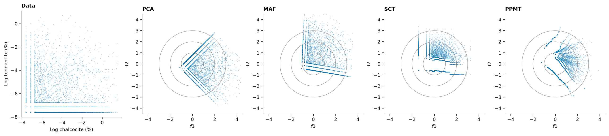

# Multivariate transforms

Cosimulating correlated grades is simpler on independent factors: simulate each factor alone, then transform back.
Four transforms reach independence to different degrees. PCA and min/max autocorrelation factors (MAF) are linear
rotations, which remove correlation and leave curved dependence. The stepwise conditional transform (SCT) and the
projection-pursuit multivariate transform (PPMT) are nonlinear and Gaussian by construction.
[Multivariate simulation](../../08-stochastic-simulation/06-multivariate-simulation/README.md) simulates the factors.

<details><summary>Python</summary>

```python
import boitata as bt
import matplotlib.pyplot as plt
import numpy as np
from common import ACCENT, GRAY, save

data = bt.datasets.porphyry_geometallurgy(deposit=1)["synthetic_drillholes"]
pair = np.log(np.column_stack([data["calcosina"], data["tenantita"]]))
names = ["Log chalcocite (%)", "Log tennantite (%)"]
print(f"{len(pair)} composites, correlation {np.corrcoef(pair.T)[0, 1]:.2f}")
```

</details>

```text
7213 composites, correlation 0.12
```

PCA rotates onto the eigenvectors of the correlation matrix. MAF rotates the sphered data onto the eigenvectors of its
variogram matrix at one lag (5 m, the composite length), so the factors are also uncorrelated at that lag, most
continuous first. SCT normal-scores the second variable within classes of the first; PPMT normal-scores each variable,
then Gaussianizes the least Gaussian projections in turn.

<details><summary>Python</summary>

```python
transforms = {
    "PCA": bt.PCA(standardize=True).fit(pair),
    "MAF": bt.MAF(lag=5.0, tolerance=1.0).fit(pair, data.coords),
    "SCT": bt.StepwiseConditional(classes=12).fit(pair),
    "PPMT": bt.PPMT(seed=7).fit(pair),
}
factors = {name: t.transform(pair) for name, t in transforms.items()}

print(f"{'':6}{'r(f1, f2)':>11}{'r(f1², f2)':>12}{'skew f2':>9}{'round trip':>12}")
for name, f in factors.items():
    back = transforms[name].inverse_transform(f)
    skew = ((f[:, 1] - f[:, 1].mean()) ** 3).mean() / f[:, 1].std() ** 3
    r2 = np.corrcoef(f[:, 0] ** 2, f[:, 1])[0, 1]
    error = np.abs(back - pair).max()
    print(f"{name:6}{np.corrcoef(f.T)[0, 1]:11.3f}{r2:12.3f}{skew:9.2f}{error:12.1e}")
print("PCA explained variance ratio:", np.round(transforms["PCA"].explained_variance_ratio_, 3))
print("MAF variogram of each factor at 5 m:", np.round(transforms["MAF"].gammas_, 3))
```

</details>

```text
        r(f1, f2)  r(f1², f2)  skew f2  round trip
PCA         0.000      -0.178    -0.35     3.0e-15
MAF        -0.000      -0.008     1.90     4.0e-15
SCT         0.003       0.012     0.98     1.5e-16
PPMT       -0.958       0.965    59.02     3.3e-08
PCA explained variance ratio: [0.56 0.44]
MAF variogram of each factor at 5 m: [0.177 0.222]
```

The data and the four sets of factors. Linear factors are uncorrelated but keep the L-shaped cloud of two mineral
associations; the nonlinear ones fill the standard bivariate normal.

<details><summary>Python</summary>

```python
fig, axes = plt.subplots(1, 5, figsize=(16, 3.5), layout="constrained")
axes[0].scatter(pair[:, 0], pair[:, 1], s=2, color=ACCENT, alpha=0.3, linewidths=0)
axes[0].set(xlabel=names[0], ylabel=names[1], title="Data")
t = np.linspace(0, 2 * np.pi, 200)
for ax, (name, f) in zip(axes[1:], factors.items()):
    ax.scatter(f[:, 0], f[:, 1], s=2, color=ACCENT, alpha=0.3, linewidths=0)
    for radius in (1, 2, 3):
        ax.plot(radius * np.cos(t), radius * np.sin(t), color=GRAY, lw=0.6)
    ax.set(xlim=(-4.5, 4.5), ylim=(-4.5, 4.5), xlabel="f1", ylabel="f2", title=name, aspect="equal")
save(fig, "factors")
```

</details>



Every transform returns the data exactly and leaves uncorrelated factors. PCA and MAF keep some dependence (r(f1², f2)
of 0.07 and −0.08), and MAF leaves a skewed second factor (1.90). SCT and PPMT bring both to about 0, so you can
simulate their factors one at a time and keep the shape of the cloud.

Full script: [`example_04_05.py`](example_04_05.py)
