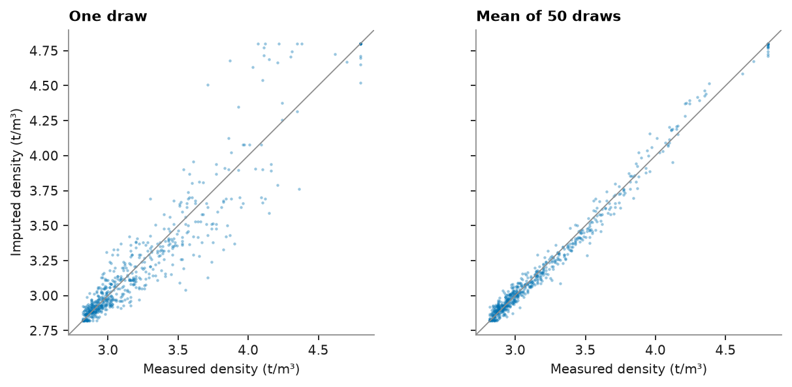
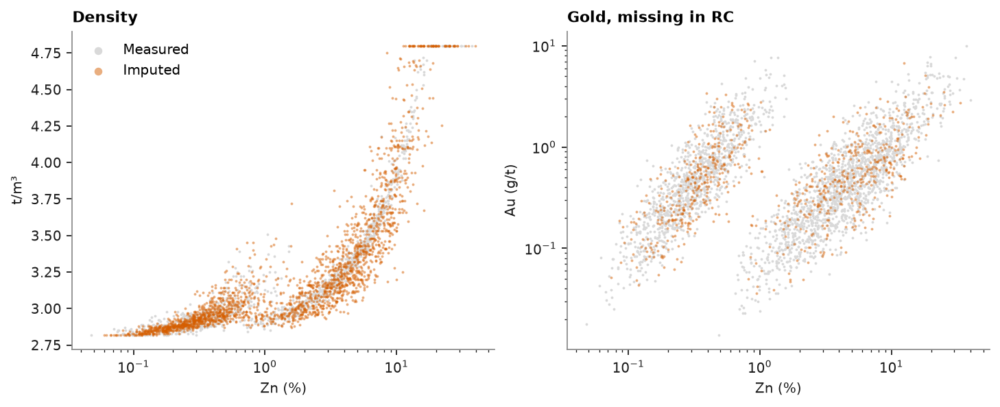
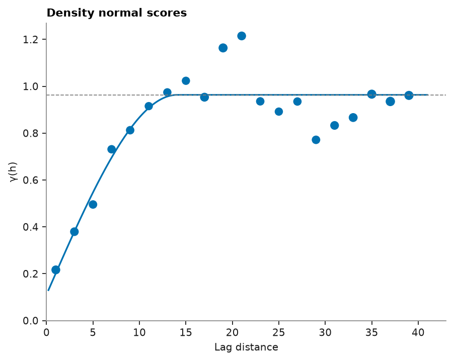
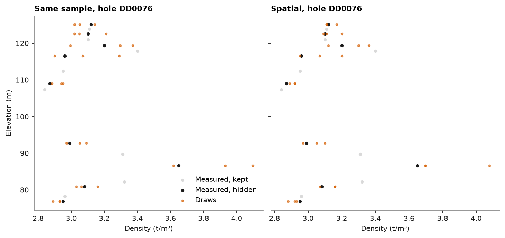

# Imputation

Not every sample is assayed for every variable. In the stacked sulfide lenses, density was measured on about half of
the diamond core from the sulfide units and never on RC chips, and the RC holes have no gold assays. The grades Zn,
Pb, Cu and Ag are complete. `GaussianImputer` fills the gaps: it normal-scores each variable on its own values, fits
the correlation of the scores to all rows, and draws each missing score given the scores present in its row. With
`spatial=`, it also draws from nearby samples.

<details><summary>Python</summary>

```python
import boitata as bt
import matplotlib.pyplot as plt
import numpy as np
from common import ACCENT, GRAY, HIGHLIGHT, INK, LIGHT, save

lenses = bt.datasets.stacked_sulphide_lenses()
samples = bt.merge_intervals(lenses["assays"], lenses["lithology"])
sulphide = samples.filter(np.isin(samples["LITH"], ["MS", "SMS", "STR"])).drop_null("ZN_PCT")
columns = ["ZN_PCT", "PB_PCT", "CU_PCT", "AG_GPT", "AU_GPT", "DENSITY"]
labels = ["Zn", "Pb", "Cu", "Ag", "Au", "density"]
data = np.column_stack([sulphide[c] for c in columns])
missing = np.isnan(data)
print(
    f"{len(data)} sulphide samples, missing: "
    + ", ".join(f"{n} {m.sum()}" for n, m in zip(labels, missing.T))
)
```

</details>

```text
3325 sulphide samples, missing: Zn 0, Pb 0, Cu 0, Ag 0, Au 741, density 2104
```

The scores of density follow Zn, Pb and Ag closely. Gold is weakly tied to the others, so its drawn values carry more
of their own randomness.

<details><summary>Python</summary>

```python
imputer = bt.GaussianImputer(seed=0).fit(data)
print("score correlation")
print(" " * 8 + "".join(f"{n:>8}" for n in labels))
for name, row in zip(labels, imputer.correlation_):
    print(f"{name:8}" + "".join(f"{r:8.2f}" for r in row))
```

</details>

```text
score correlation
              Zn      Pb      Cu      Ag      Au density
Zn          1.00    1.00   -0.11    0.94    0.49    0.94
Pb          1.00    1.00   -0.08    0.96    0.52    0.95
Cu         -0.11   -0.08    1.00    0.10    0.63    0.04
Ag          0.94    0.96    0.10    1.00    0.66    0.94
Au          0.49    0.52    0.63    0.66    1.00    0.58
density     0.94    0.95    0.04    0.94    0.58    1.00
```

To check the method, hide the measured density of every other hole, impute it, and compare with the truth: one draw,
and the mean of 50 draws with different seeds, close to the conditional mean.

<details><summary>Python</summary>

```python
holes = sulphide["HOLE_ID"]
test = ~missing[:, 5] & np.isin(holes, np.unique(holes)[::2])
holed = data.copy()
holed[test, 5] = np.nan
draws = np.array([bt.GaussianImputer(seed=s).fit(holed).transform(holed)[test, 5] for s in range(50)])
truth = data[test, 5]
qs = [0.1, 0.5, 0.9]
print(f"{test.sum()} densities hidden")
for name, x in {"truth": truth, "one draw": draws[0], "mean of 50": draws.mean(axis=0)}.items():
    q = ", ".join(f"{v:.2f}" for v in np.quantile(x, qs))
    rmse = bt.compare(x, truth)["rmse"]
    print(f"{name:11} q10, q50, q90: {q}   sd {x.std():.2f}" + (f"   rmse {rmse:.2f}" if rmse else ""))

fig, axes = plt.subplots(1, 2, figsize=(8, 3.6), layout="constrained", sharex=True, sharey=True)
for ax, (x, title) in zip(axes, [(draws[0], "One draw"), (draws.mean(axis=0), "Mean of 50 draws")]):
    ax.scatter(truth, x, s=4, color=ACCENT, alpha=0.4, linewidths=0)
    ax.axline((3, 3), slope=1, color=GRAY, lw=0.8)
    ax.set(xlabel="Measured density (t/m³)", title=title, aspect="equal")
axes[0].set_ylabel("Imputed density (t/m³)")
save(fig, "check")
```

</details>

```text
609 densities hidden
truth       q10, q50, q90: 2.86, 3.05, 3.83   sd 0.44
one draw    q10, q50, q90: 2.87, 3.06, 3.70   sd 0.45   rmse 0.16
mean of 50  q10, q50, q90: 2.87, 3.06, 3.82   sd 0.44   rmse 0.05
```



One draw keeps the spread of the hidden densities (sd 0.45 against 0.44), with a root-mean-square error of 0.16 t/m³.
The mean of 50 draws cuts the error to 0.05 but narrows the spread to 0.44, like any prediction. Draws suit simulation
and tonnage uncertainty; the mean suits a single best value per sample.

One draw fills every gap below. The imputed densities follow the trend of the measured ones against zinc, with the
same scatter.

<details><summary>Python</summary>

```python
filled = imputer.transform(data)
fig, axes = plt.subplots(1, 2, figsize=(9, 3.6), layout="constrained")
for ax, j, title, label in ((axes[0], 5, "Density", "t/m³"), (axes[1], 4, "Gold, missing in RC", "Au (g/t)")):
    gap = missing[:, j]
    ax.scatter(data[~gap, 0], data[~gap, j], s=3, color=LIGHT, linewidths=0, label="Measured")
    ax.scatter(filled[gap, 0], filled[gap, j], s=3, color=HIGHLIGHT, alpha=0.5, linewidths=0, label="Imputed")
    ax.set(xlabel="Zn (%)", ylabel=label, xscale="log", title=title)
axes[1].set_yscale("log")
axes[0].legend(markerscale=3)
save(fig, "filled")
print(f"density mean {np.nanmean(data[:, 5]):.3f} measured, {filled[:, 5].mean():.3f} after imputation")
```

</details>

```text
density mean 3.245 measured, 3.245 after imputation
```



The imputer assumes that missing values behave like measured ones with the same grades. That holds for density here,
measured on part of the same core; gold in RC chips borrows its relation to the base metals from the diamond holes.
`MultivariateSimulation.fit(..., impute=True)` redraws the gaps in every realization
([multivariate simulation](../../10-simulation/05-multivariate-simulation/README.md)).

## Spatial imputation

With `spatial=`, the normal scores follow an intrinsic model, in which every variable and every pair of variables
share one correlogram scaled by the score covariance. The imputer visits the samples along a random path and draws
each missing score by simple cokriging from its own row and from the nearest samples, those already imputed
included. The samples below are desurveyed, so density can be counted over the whole campaign: it is missing in 94%
of all samples and in about half of the sulfide ones.

<details><summary>Python</summary>

```python
intervals = bt.merge_intervals(lenses["assays"], lenses["lithology"])
samples = bt.Drillholes(lenses["collars"], lenses["surveys"], intervals).samples()
density = samples["DENSITY"]
sulphide = samples.filter(np.isin(samples["LITH"], ["MS", "SMS", "STR"])).drop_null("ZN_PCT")
columns = ["ZN_PCT", "PB_PCT", "CU_PCT", "AG_GPT", "AU_GPT", "DENSITY"]
data = np.column_stack([sulphide[c] for c in columns])
xyz, holes = sulphide.coords, sulphide["HOLE_ID"]
seen = ~np.isnan(data[:, 5])
print(f"density missing in {np.isnan(density).mean():.0%} of {len(density)} samples")
print(f"{len(data)} sulphide samples, density measured in {seen.sum()}")
```

</details>

```text
density missing in 94% of 20095 samples
3325 sulphide samples, density measured in 1221
```

The spatial model is the variogram of the density normal scores, on 2 m lags: a small nugget and a range of about 14
m, shorter than the spacing between holes, so most of the information comes from the samples above and below in the
same hole. The imputer rescales its sill to one.

<details><summary>Python</summary>

```python
scores = bt.NormalScore().fit_transform(data[seen, 5])
experimental = bt.experimental_variogram(xyz[seen], scores, 2.0, 40.0)
model = experimental.fit("spherical")
nugget, (structure,) = model.nugget, model.structures
print(f"nugget {nugget:.2f}, spherical sill {structure.sill:.2f}, range {structure.range:.1f} m")
fig, ax = bt.plot.variogram(experimental, variogram=model)
ax.set(title="Density normal scores")
save(fig, "variogram")
```

</details>

```text
nugget 0.11, spherical sill 0.85, range 14.0 m
```



Two checks hide measured densities and score the imputed ones against the truth: every other hole, as in the check
above, and every other measured sample, which leaves the neighbors in the same hole. Each imputer runs with 10
seeds, and both the error of one draw and that of the mean of the draws are root-mean-square.

<details><summary>Python</summary>

```python
order = np.flatnonzero(seen)
tests = {
    "every other hole": seen & np.isin(holes, np.unique(holes[seen])[::2]),
    "every other sample": np.isin(np.arange(len(data)), order[::2]),
}
imputers = {
    "same sample": lambda seed, holed: bt.GaussianImputer(seed=seed).fit(holed),
    "spatial": lambda seed, holed: bt.GaussianImputer(seed=seed, spatial=model).fit(holed, coords=xyz),
}
draws = {}
print(f"{'hidden':20}{'imputer':13}{'one draw':>9}{'mean':>7}{'sd':>6}")
for test, hidden in tests.items():
    holed = data.copy()
    holed[hidden, 5] = np.nan
    truth = data[hidden, 5]
    for name, make in imputers.items():
        d = np.array([make(seed, holed).transform(holed)[hidden, 5] for seed in range(10)])
        draws[test, name] = d
        one, mean = (bt.compare(x, truth)["rmse"] for x in (d[0], d.mean(axis=0)))
        print(f"{test:20}{name:13}{one:9.3f}{mean:7.3f}{d[0].std():6.2f}")
    print(f"{test:20}{'truth':13}{'':16}{truth.std():6.2f}")
```

</details>

```text
hidden              imputer       one draw   mean    sd
every other hole    same sample      0.172  0.073  0.45
every other hole    spatial          0.178  0.074  0.46
every other hole    truth                          0.43
every other sample  same sample      0.148  0.071  0.47
every other sample  spatial          0.129  0.078  0.47
every other sample  truth                          0.46
```

Across holes the neighbors add almost nothing, since the hidden holes lie beyond the range of the variogram. Within
holes, one spatial draw errs by 0.13 t/m³ against 0.15 from the same sample alone, and both keep the spread of the
truth. Along one hole, the spatial draws follow the level of the measured densities around them.

<details><summary>Python</summary>

```python
hidden = tests["every other sample"]
counts = {h: (hidden & (holes == h)).sum() for h in np.unique(holes)}
hole = max(counts, key=counts.get)
rows = np.flatnonzero(holes == hole)
at = np.flatnonzero(hidden)
fig, axes = plt.subplots(1, 2, figsize=(9, 4.2), layout="constrained", sharey=True)
for ax, name in zip(axes, imputers):
    d = draws["every other sample", name]
    pick = np.isin(at, rows)
    kept = rows[~hidden[rows] & seen[rows]]
    ax.scatter(data[kept, 5], xyz[kept, 2], s=10, color=LIGHT, label="Measured, kept")
    ax.scatter(data[at[pick], 5], xyz[at[pick], 2], s=10, color=INK, label="Measured, hidden")
    for k in range(3):
        ax.scatter(
            d[k, pick], xyz[at[pick], 2], s=6, color=HIGHLIGHT, alpha=0.6, label="Draws" if k == 0 else None
        )
    ax.set(xlabel="Density (t/m³)", title=f"{name.capitalize()}, hole {hole}")
axes[0].set_ylabel("Elevation (m)")
axes[0].legend(loc="lower right")
save(fig, "downhole")
```

</details>



The draws also keep the correlations. The normal-score correlation of density with Zn, Pb and Ag over the hidden
samples, averaged over the draws, against the correlation fitted to the data:

<details><summary>Python</summary>

```python
hidden = tests["every other sample"]
holed = data.copy()
holed[hidden, 5] = np.nan
target = bt.GaussianImputer().fit(holed).correlation_[5]
ns = [bt.NormalScore().fit(data[:, j]) for j in (0, 1, 3)]
for name in imputers:
    d = draws["every other sample", name]
    z = [bt.NormalScore().fit(data[seen, 5]).transform(x) for x in d]
    r = [
        np.mean([np.corrcoef(n.transform(data[hidden, j]), zk)[0, 1] for zk in z])
        for n, j in zip(ns, (0, 1, 3))
    ]
    print(f"{name:12}" + "".join(f"{v:7.2f}" for v in r))
print(f"{'fitted':12}" + "".join(f"{target[j]:7.2f}" for j in (0, 1, 3)))
```

</details>

```text
same sample    0.94   0.94   0.94
spatial        0.94   0.95   0.94
fitted         0.95   0.95   0.94
```

Both stay within 0.03 of the fitted correlations. Only the missing entries change, and the imputer returns measured
values as they are. `transform` takes `coords=` for new samples and otherwise reuses those given to `fit`. A
pure-nugget variogram gives the same draws as the non-spatial imputer, and `MultivariateSimulation.fit(...,
impute=bt.GaussianImputer(spatial=model))` redraws the gaps this way in every realization
([multivariate simulation](../../10-simulation/05-multivariate-simulation/README.md)).

The intrinsic model is the simplest spatial model with the fitted correlations: one correlogram for all variables.
Here it comes from density, the variable being imputed, and grades with a different continuity borrow it too.

Full script: [`example_06_06.py`](example_06_06.py)
