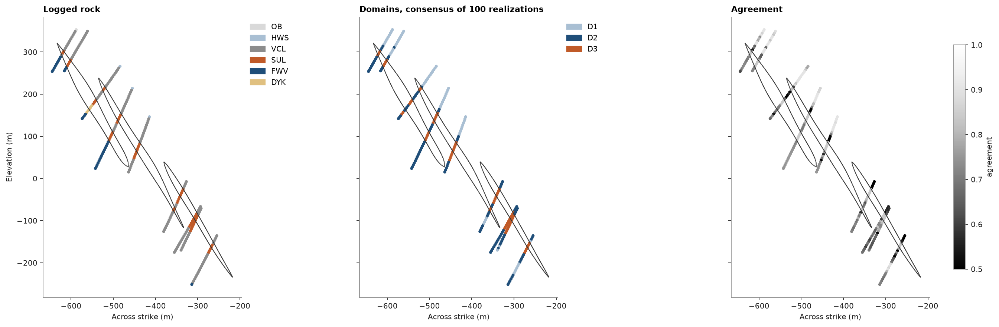

# ensemble domains

a domain is a volume where a grade can be treated as stationary. `domains` proposes domains from the samples alone,
after Martin and Boisvert (2018): it standardizes the columns and clusters them with k-means on features taken from
each sample's spatial neighbors, so the clusters follow the grades and stay together in space. the consensus repeats
two spatial clusterings over random neighborhood sizes and column subsets, then clusters how often each pair of
samples ends up in the same cluster. the result holds one code per sample, ready for a column or `domains=`, and two
scores: the spread of the columns within the domains (`wcss`) and the entropy of the domains around each sample
(`spatial_entropy`).

<details><summary>Python</summary>

```python
import boitata as bt
import matplotlib.pyplot as plt
import numpy as np
from common import save
```

</details>

## four metals

5 m composites of the stacked sulphide lenses with zinc, lead, copper and silver, and the logged rock for
comparison. the grades are skewed over three orders of magnitude, so the clustering takes their logarithms: on the
raw grades the richest composites would dominate the squared distances of k-means.

<details><summary>Python</summary>

```python
data = bt.datasets.stacked_sulphide_lenses()
intervals = bt.merge_intervals(data["assays"], data["lithology"])
drillholes = bt.Drillholes(data["collars"], data["surveys"], intervals)
metals = ["ZN_PCT", "PB_PCT", "CU_PCT", "AG_GPT"]
composites = drillholes.composite(5.0, metals, categories=["LITH"])
logs = {f"log_{m}": np.log10(np.maximum(composites[m], 1e-3)) for m in metals}
composites = composites.with_columns(logs)
rocks = bt.Categories(
    ["OB", "HWS", "VCL", "SUL", "FWV"],
    mapping={"MS": "SUL", "SMS": "SUL", "STR": "SUL"},
    other="DYK",
    colors=["#d9d9d9", "#a9bfd3", "#8c8c8c", "#c05a28", "#1f4e79", "#e0c080"],
)
rock = rocks.encode(composites["LITH"])
print(f"{len(composites):,} composites in {len(drillholes)} holes")
```

</details>

```text
5,453 composites in 289 holes
```

## three domains

the consensus of 100 realizations, half autocorrelation clusterings (each column and its mean over the nearest
composites) and half dual-space searches (the mean over the nearest composites in space that are also nearest in
the metals). codes run by increasing mean of the first column, zinc, and `scheme` names them `D1` to `D3`.

<details><summary>Python</summary>

```python
found = bt.domains(composites, list(logs), 3, seed=7)
print(found)
domains = bt.Categories(found.scheme.names, colors=["#a9bfd3", "#1f4e79", "#c05a28"])
composites = composites.with_columns({"domain": found.labels, "agreement": found.agreement})
print(f"{'':<4}{'n':>6}{'Zn %':>7}{'Pb %':>7}{'Cu %':>7}{'Ag g/t':>8}")
for c, name in enumerate(domains.names):
    inside = found.labels == c
    means = [np.mean(composites[m][inside]) for m in metals]
    print(f"{name:<4}{inside.sum():6d}" + "".join(f"{v:7.2f}" for v in means[:3]) + f"{means[3]:8.1f}")
```

</details>

```text
Domains(k=3, wcss=1.024, spatial_entropy=0.444)
         n   Zn %   Pb %   Cu %  Ag g/t
D1    2549   0.05   0.02   0.01     1.0
D2    2153   0.06   0.02   0.03     1.2
D3     751   3.90   1.48   0.62    33.4
```

the domains were drawn from the metals only, yet they line up with the logged rock: `D3` holds the sulphides and
their volcaniclastic margin, while the barren rock splits in two, the hanging wall sediments with the
volcaniclastics above the lenses in `D1` and the footwall volcanics with those below in `D2`. each row below is a
rock's composites shared among the domains.

<details><summary>Python</summary>

```python
print(f"{'':<5}" + "".join(f"{name:>6}" for name in domains.names) + f"{'n':>7}")
for r, name in enumerate(rocks.names):
    inside = rock == r
    shares = domains.shares(found.labels[inside])
    print(f"{name:<5}" + "".join(f"{s:6.0%}" for s in shares) + f"{inside.sum():7d}")
```

</details>

```text
         D1    D2    D3      n
OB      88%   12%    0%     25
HWS     99%    1%    0%    627
VCL     55%   42%    3%   3426
SUL      0%    3%   97%    653
FWV      1%   97%    2%    693
DYK     28%   62%   10%     29
```

## on a section

the composites within 25 m of a vertical section across strike, with the outlines of the three lenses. the
agreement is a composite's mean share of realizations in which it falls with the other composites of its domain:
near 1 inside a domain, lower along the contacts where the realizations disagree.

<details><summary>Python</summary>

```python
lenses = [data[f"lens_{i}"] for i in (1, 2, 3)]
plane = ((12350.0, 29900.0, 0.0), 113.0, 90)
fig, axes = plt.subplots(1, 3, figsize=(17, 5.4), layout="constrained", sharey=True)
options = {"plane": plane, "thickness": 50.0, "meshes": lenses, "s": 7}
bt.plot.slab(composites, rock, scheme=rocks, ax=axes[0], **options)
axes[0].set_title("Logged rock")
bt.plot.slab(composites, "domain", scheme=domains, ax=axes[1], **options)
axes[1].set_title("Domains, consensus of 100 realizations")
bt.plot.slab(composites, "agreement", vmin=0.5, vmax=1.0, cmap="Greys_r", ax=axes[2], **options)
axes[2].set_title("Agreement")
for ax, y in zip(axes, ["Elevation (m)", "", ""]):
    ax.set(xlabel="Across strike (m)", ylabel=y)
save(fig, "section")
```

</details>



## the three methods

a lower `wcss` means domains more uniform in the metals, a lower `spatial_entropy` domains less mixed among
neighbors. here the consensus gives the most uniform domains and a single autocorrelation clustering the least
mixed ones. the two scores pull against each other, so they compare candidate domainings (methods, columns, `k`)
rather than pick one alone.

<details><summary>Python</summary>

```python
print(f"{'method':<17}{'wcss':>6}{'entropy':>9}")
for method in ["autocorrelation", "dual", "consensus"]:
    d = bt.domains(composites, list(logs), 3, method=method, seed=7)
    print(f"{method:<17}{d.wcss:6.3f}{d.spatial_entropy:9.3f}")
```

</details>

```text
method             wcss  entropy
autocorrelation   1.109    0.401
dual              1.273    0.414
consensus         1.024    0.444
```

Full script: [`example_07_09.py`](example_07_09.py)
