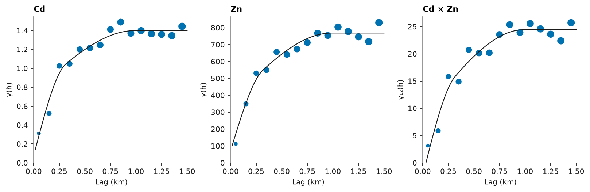
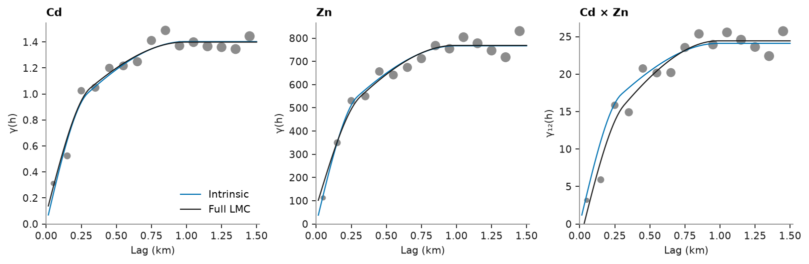

# Coregionalization

Topsoil metals: 259 soil samples of heavy metals (mg/kg, coordinates in km). Cd correlates with Zn. A linear model of
coregionalization (LMC) describes both variograms and their cross-variogram with one set of structures, each with its
own sill matrix. An intrinsic coregionalization is the simplest such model: every direct and cross variogram shares
one normalized shape, scaled by one entry of a covariance matrix, so the correlation is the same at every lag.
`Coregionalization.fit(..., intrinsic=True)` fits that shape, and `Coregionalization.intrinsic` builds one from a
variogram and a matrix. Either result is an ordinary `Coregionalization`, so cokriging and cosimulation take it
unchanged.

<details><summary>Python</summary>

```python
import boitata as bt
import matplotlib.pyplot as plt
import numpy as np
from common import ACCENT, GRAY, INK, save

soil = bt.datasets.topsoil_metals()
samples, test = soil["prediction"], soil["validation"]
xy = samples.coords
cd, zn = samples["Cd"], samples["Zn"]
lag, max_lag = 0.1, 1.5
print(f"{len(cd)} samples, corr(Cd, Zn) {np.corrcoef(cd, zn)[0, 1]:.2f}")
```

</details>

```text
259 samples, corr(Cd, Zn) 0.74
```

The cross-variogram is half the mean product of the Cd and Zn increments between co-located samples. The LMC fits the
two variograms and the cross-variogram together. The variables share the structures, a nugget and two spherical
ranges, and each structure's sill matrix stays positive semi-definite: its smallest eigenvalue is never negative. The
short structure takes the place of the nugget, which fits to zero.

<details><summary>Python</summary>

```python
experimentals = [
    [
        bt.experimental_variogram(xy, cd, lag, max_lag),
        bt.experimental_variogram(xy, cd, lag, max_lag, other=zn),
    ],
    [None, bt.experimental_variogram(xy, zn, lag, max_lag)],
]
lmc = bt.Coregionalization.fit(experimentals, ["spherical", "spherical"])
for name, matrix in [("nugget", lmc.nugget)] + [(f"{m} {a:.2f} km", s) for m, a, s in lmc.structures]:
    print(f"{name}: {np.round(matrix, 3).tolist()}, smallest eigenvalue {np.linalg.eigvalsh(matrix)[0]:.3g}")
```

</details>

```text
nugget: [[0.076, -2.336], [-2.336, 72.012]], smallest eigenvalue -1.39e-17
spherical 0.32 km: [[0.668, 10.759], [10.759, 287.019]], smallest eigenvalue 0.264
spherical 0.99 km: [[0.655, 16.011], [16.011, 409.632]], smallest eigenvalue 0.0291
```

Each curve is the fitted LMC's C(0) − C(h). The three experimental variograms follow the shared short and long
structures in their own proportions:

<details><summary>Python</summary>

```python
h = np.linspace(0, max_lag, 101)[1:]
origin = np.zeros((h.size, 3))
away = np.c_[h, np.zeros((h.size, 2))]
panels = (
    (0, 0, "Cd", experimentals[0][0]),
    (1, 1, "Zn", experimentals[1][1]),
    (0, 1, "Cd × Zn", experimentals[0][1]),
)
fig, axes = plt.subplots(1, 3, figsize=(10, 3.2), layout="constrained")
for ax, (i, j, name, experimental) in zip(axes, panels):
    bt.plot.variogram(experimental, ax=ax, color=ACCENT)
    model = lmc.cross_covariance(i, j, origin, origin) - lmc.cross_covariance(i, j, origin, away)
    ax.plot(h, model, color=INK, lw=1)
    ax.set(title=name, xlabel="Lag (km)", ylabel="γ(h)" if i == j else "γ₁₂(h)")
save(fig, "variograms")
```

</details>



Given directional variograms, the fit also finds the anisotropy the structures share, searching the angles and range
ratios together with the sill matrices. Cd and Zn are most continuous along a north-west to south-east axis.

<details><summary>Python</summary>

```python
azimuths = [0.0, 45.0, 90.0, 135.0]


def directional(u, v=None):
    return [bt.experimental_variogram(xy, u, lag, max_lag, azimuth=a, other=v) for a in azimuths]


anisotropic = bt.Coregionalization.fit(
    [[directional(cd), directional(cd, zn)], [None, directional(zn)]],
    ["spherical", "spherical"],
    directions=[(a, 0.0) for a in azimuths],
)
print(
    f"major axis azimuth {anisotropic.rotation[0]:.0f}°, semi-major/major ratio {anisotropic.ratios[0]:.2f}, "
    f"major ranges {', '.join(f'{r:.2f}' for _, r, _ in anisotropic.structures)} km"
)
```

</details>

```text
major axis azimuth 120°, semi-major/major ratio 0.52, major ranges 0.46, 1.45 km
```

## Intrinsic coregionalization

`experimental_variograms` computes both variograms and the cross-variogram as a `VariogramSet`, which the fit takes
as it is. The intrinsic model has one shape (a nugget and two spherical structures) and one 2 × 2 sill matrix. The
full LMC fitted to the same set gives each variable its own mix of the shared structures.

<details><summary>Python</summary>

```python
experimentals = bt.experimental_variograms(samples, ["Cd", "Zn"], lag, max_lag)
icm = bt.Coregionalization.fit(experimentals, ["spherical", "spherical"], intrinsic=True)
lmc = bt.Coregionalization.fit(experimentals, ["spherical", "spherical"])


def sill(model):
    return model.nugget + sum(s for _, _, s in model.structures)


for name, model in [("intrinsic", icm), ("full LMC", lmc)]:
    c = sill(model)
    parts = ", ".join(
        f"{label} {100 * s[0, 0] / c[0, 0]:.0f} / {100 * s[1, 1] / c[1, 1]:.0f} %"
        for label, s in [("nugget", model.nugget), *((f"{m} {a:.2f} km", s) for m, a, s in model.structures)]
    )
    print(
        f"{name}: sills Cd {c[0, 0]:.3f}, Zn {c[1, 1]:.0f}, correlation {c[0, 1] / np.sqrt(c[0, 0] * c[1, 1]):.2f}"
    )
    print(f"  share of the Cd / Zn sill: {parts}")
```

</details>

```text
intrinsic: sills Cd 1.403, Zn 767, correlation 0.73
  share of the Cd / Zn sill: nugget 0 / 0 %, spherical 0.30 km 50 / 50 %, spherical 0.99 km 50 / 50 %
full LMC: sills Cd 1.399, Zn 769, correlation 0.75
  share of the Cd / Zn sill: nugget 5 / 9 %, spherical 0.32 km 48 / 37 %, spherical 0.99 km 47 / 53 %
```

Cd puts 83 % of its sill in the short structure, Zn 53 %. The intrinsic model gives both the same 68 %, a
compromise, and one correlation, 0.64, at every lag. The total sills and the correlation differ little between the
two models, so the curves meet at large lags. At short lags the intrinsic model is too smooth for Cd and too rough
for Zn:

<details><summary>Python</summary>

```python
h = np.linspace(0, max_lag, 101)[1:]
origin = np.zeros((h.size, 3))
away = np.c_[h, np.zeros((h.size, 2))]
panels = ((0, 0, "Cd"), (1, 1, "Zn"), (0, 1, "Cd × Zn"))
fig, axes = plt.subplots(1, 3, figsize=(10, 3.2), layout="constrained")
for ax, (i, j, name) in zip(axes, panels):
    bt.plot.variogram(experimentals[i, j], ax=ax, color=GRAY)
    for model, color, label in [(icm, ACCENT, "Intrinsic"), (lmc, INK, "Full LMC")]:
        gamma = model.cross_covariance(i, j, origin, origin) - model.cross_covariance(i, j, origin, away)
        ax.plot(h, gamma, color=color, lw=1, label=label)
    ax.set(title=name, xlabel="Lag (km)", ylabel="γ(h)" if i == j else "γ₁₂(h)")
axes[0].legend()
save(fig, "intrinsic")
```

</details>



## Cokriging with either model

Both models go to `Cokriging` the same way. The test kriges Cd at the 100 validation samples by collocated cokriging,
with Zn known there, as in [cokriging](../../09-estimation/09-cokriging/README.md). With correlations this close, the
simpler model predicts as well:

<details><summary>Python</summary>

```python
search = bt.Search(radius=1.5, max_samples=24, min_samples=4)
truth = test["Cd"]
for name, model in [("intrinsic", icm), ("full LMC", lmc)]:
    ck = bt.Cokriging(model, search, means=[cd.mean(), zn.mean()])
    ck.fit(np.vstack([xy, xy]), np.r_[cd, zn], [0] * len(cd) + [1] * len(zn))
    estimate = ck.predict(test, collocated={1: test["Zn"]})
    print(f"{name:>10}: validation RMSE {bt.compare(estimate, truth)['rmse']:.3f} mg/kg")
```

</details>

```text
 intrinsic: validation RMSE 0.696 mg/kg
  full LMC: validation RMSE 0.652 mg/kg
```

## Seven metals

The intrinsic model grows with the number of variables only through its covariance matrix: seven metals need one shape
and 28 matrix entries, fitted in one pass. Its correlations hold at every lag:

<details><summary>Python</summary>

```python
metals = ["Cd", "Co", "Cr", "Cu", "Ni", "Pb", "Zn"]
seven = bt.Coregionalization.fit(
    bt.experimental_variograms(samples, metals, lag, max_lag), ["spherical", "spherical"], intrinsic=True
)
c = sill(seven)
corr = c / np.sqrt(np.outer(np.diag(c), np.diag(c)))
print(f"smallest eigenvalue of the sill matrix {np.linalg.eigvalsh(c)[0]:.3g}")
print("      " + "".join(f"{m:>6}" for m in metals))
for m, row in zip(metals, corr):
    print(f"{m:<6}" + "".join(f"{r:6.2f}" for r in row))
```

</details>

```text
smallest eigenvalue of the sill matrix 0.523
          Cd    Co    Cr    Cu    Ni    Pb    Zn
Cd      1.00  0.61  0.72  0.22  0.62  0.31  0.73
Co      0.61  1.00  0.70  0.19  0.80  0.23  0.66
Cr      0.72  0.70  1.00  0.22  0.71  0.29  0.76
Cu      0.22  0.19  0.22  1.00  0.22  0.60  0.52
Ni      0.62  0.80  0.71  0.22  1.00  0.26  0.75
Pb      0.31  0.23  0.29  0.60  0.26  1.00  0.52
Zn      0.73  0.66  0.76  0.52  0.75  0.52  1.00
```

Full script: [`example_07_07.py`](example_07_07.py)
