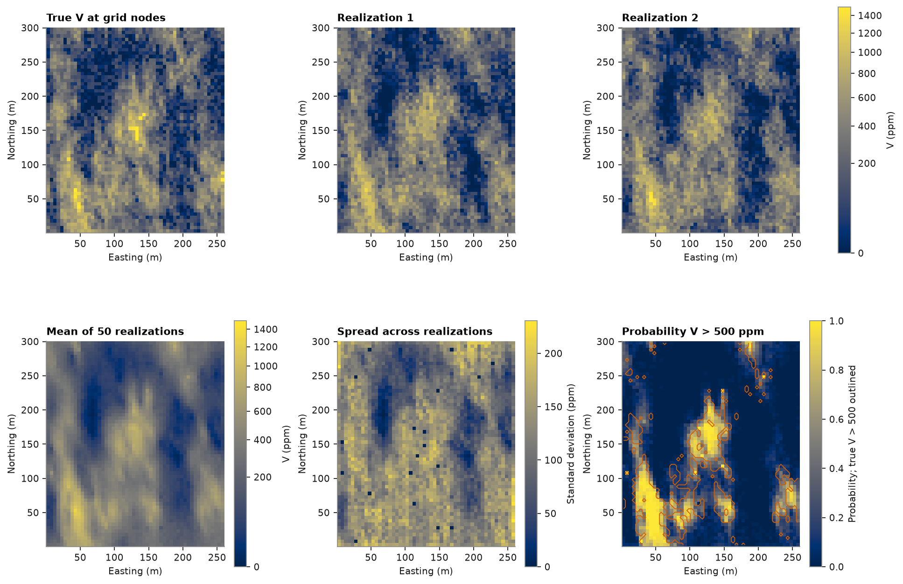
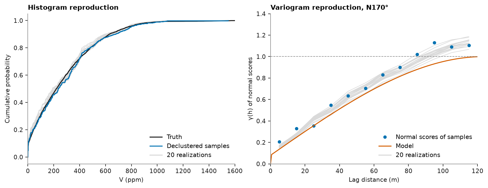
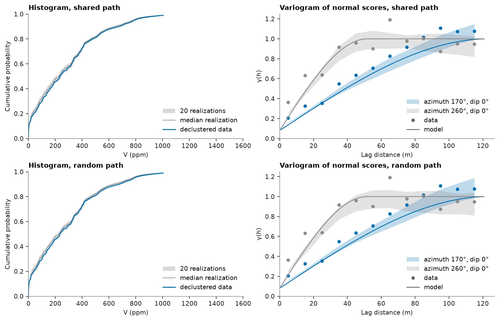

# Sequential Gaussian simulation

Kriging gives one smooth map. Simulation draws many maps, each honoring the samples, the declustered histogram and
the variogram; together they measure uncertainty. On a block model, SGS can run every realization along one multigrid
path and reuse the kriging weights, or draw a new path each time.

<details><summary>Python</summary>

```python
import boitata as bt
import matplotlib.pyplot as plt
import numpy as np
from common import ACCENT, GRAY, HIGHLIGHT, INK, LIGHT, map_axes, save
from matplotlib.colors import PowerNorm

samples = bt.datasets.clustered_metal_survey()
truth = bt.datasets.clustered_metal_survey_exhaustive()["V"].reshape(300, 260)
xy, v = samples.coords, samples["V"]
azimuth = 170.0
```

</details>

Normal scores with declustering weights, tails bounded to 0 and the largest sample, and their variogram along
N170°, the direction of greatest continuity ([variogram fitting](../../07-variography/02-variogram-fitting/README.md)), and across it, scaled to a unit sill:

<details><summary>Python</summary>

```python
weights = bt.cell_declustering(xy, v, sizes=np.arange(2.5, 102.5, 2.5)).weights
y = bt.NormalScore(tails=(0.0, v.max())).fit_transform(v, weights=weights)

lag, max_lag = 10.0, 120.0
major = bt.experimental_variogram(xy, y, lag, max_lag, azimuth=azimuth).fit("spherical")
minor = bt.experimental_variogram(xy, y, lag, max_lag, azimuth=azimuth + 90).fit("spherical")
ratio = min(minor.structures[0].range / major.structures[0].range, 1.0)
gaussian = major.standardized().with_anisotropy((azimuth, 0, 0), (ratio, 1.0))
print(gaussian)
```

</details>

```text
Variogram  sill 1, 1 structure
  rotation  azimuth 170°, dip 0°, rake 0°
  ratios    semi/major 0.4202, minor/major 1
  structure    sill  major   semi  minor
  nugget     0.0801
  spherical  0.9199  123.4  51.86  123.4
```

SGS normal-scores the data, simulates along a random path and back-transforms. The 50 realizations come out the
same on any number of threads. `simulate` returns a summary accumulated while it runs: the mean, variance and
quantiles at each node, the probability and mean above each cutoff, and each realization's global mean and share
above the cutoffs. `cv` and `relative_error` derive from these: the spread over the mean, and half the central 90 %
interval over the mean, read from the 0.05 and 0.95 quantiles. It keeps realizations only on request: here the first
20, to check them.

<details><summary>Python</summary>

```python
grid = bt.BlockModel(origin=(0.5, 0.5), size=(5, 5), count=(52, 60))
sgs = bt.SGS(gaussian, bt.Search(radius=100, max_samples=24)).fit(samples, "V", weights=weights)
summary = sgs.simulate(grid, n=50, seed=42, cutoffs=[500.0], quantiles=[0.05, 0.95], keep=range(20))
reals = summary.realizations
etype = summary.mean
p500 = summary.probability_above[:, 0]

nodes = grid.coords.astype(int)
true_at_nodes = truth[nodes[:, 1] - 1, nodes[:, 0] - 1]
means = summary.realization_mean
print(f"realization means {means.min():.0f}-{means.max():.0f}, true {true_at_nodes.mean():.0f}")
print(f"realization variance {reals.var(axis=1).mean():.0f}, true {true_at_nodes.var():.0f}")
low, high = np.quantile(summary.realization_above[:, 0], [0.1, 0.9])
print(f"area above 500 ppm: P10 {low:.1%}, P90 {high:.1%}, true {np.mean(true_at_nodes > 500):.1%}")
error = summary.relative_error(confidence=0.9)
print(
    f"median cv {np.nanmedian(summary.cv):.2f}; nodes within ±50 % at 90 % confidence: {np.mean(error < 0.5):.0%}"
)
```

</details>

```text
realization means 257-295, true 280
realization variance 61134, true 65444
area above 500 ppm: P10 17.3%, P90 19.1%, true 18.7%
median cv 0.57; nodes within ±50 % at 90 % confidence: 19%
```

Each realization looks like the truth; their mean is smooth like kriging, and their spread measures uncertainty.

<details><summary>Python</summary>

```python
extent = (0.5, 260.5, 0.5, 300.5)
norm = PowerNorm(0.5, vmin=0, vmax=1500)
fig, axes = plt.subplots(2, 3, figsize=(12, 8.4), layout="constrained")
for ax, image, title in (
    (axes[0, 0], true_at_nodes, "True V at grid nodes"),
    (axes[0, 1], reals[0], "Realization 1"),
    (axes[0, 2], reals[1], "Realization 2"),
    (axes[1, 0], etype, "Mean of 50 realizations"),
):
    im = ax.imshow(grid.grid(image)[0], origin="lower", extent=extent, norm=norm)
    map_axes(ax, title)
fig.colorbar(im, ax=axes[0, :], shrink=0.8, label="V (ppm)")
fig.colorbar(im, ax=axes[1, 0], shrink=0.8, label="V (ppm)")
spread = axes[1, 1].imshow(grid.grid(summary.std)[0], origin="lower", extent=extent, cmap="cividis")
map_axes(axes[1, 1], "Spread across realizations")
fig.colorbar(spread, ax=axes[1, 1], shrink=0.8, label="Standard deviation (ppm)")
prob = axes[1, 2].imshow(grid.grid(p500)[0], origin="lower", extent=extent, vmin=0, vmax=1)
map_axes(axes[1, 2], "Probability V > 500 ppm")
axes[1, 2].contour(
    grid.grid((true_at_nodes > 500).astype(float))[0],
    levels=[0.5],
    origin="lower",
    extent=extent,
    colors=HIGHLIGHT,
    linewidths=0.8,
)
fig.colorbar(prob, ax=axes[1, 2], shrink=0.8, label="Probability; true V > 500 outlined")
save(fig, "maps")
```

</details>



Each realization reproduces the declustered histogram and the model variogram:

<details><summary>Python</summary>

```python
fig, (a, b) = plt.subplots(1, 2, figsize=(10, 3.8), layout="constrained")
grid_v = np.sort(true_at_nodes)
for r in reals:
    a.plot(np.sort(r), np.linspace(0, 1, r.size), color=LIGHT, lw=0.8)
a.plot(grid_v, np.linspace(0, 1, grid_v.size), color=INK, lw=1.4, label="Truth")
order = np.argsort(v)
a.step(
    v[order],
    np.cumsum(weights[order]) / weights.sum(),
    color=ACCENT,
    lw=1.4,
    where="post",
    label="Declustered samples",
)
a.plot([], [], color=LIGHT, label="20 realizations")
a.set(xlim=(0, 1600), xlabel="V (ppm)", ylabel="Cumulative probability", title="Histogram reproduction")
a.legend(loc="lower right")

xyz = grid.coords
for r in reals:
    scores = bt.NormalScore().fit_transform(r)
    exp = bt.experimental_variogram(xyz, scores, lag, max_lag, azimuth=azimuth)
    b.plot(exp.lags, exp.gammas, color=LIGHT, lw=0.8)
data_exp = bt.experimental_variogram(xy, y, lag, max_lag, azimuth=azimuth)
b.plot(data_exp.lags, data_exp.gammas, "o", color=ACCENT, ms=4, label="Normal scores of samples")
h = np.linspace(0, max_lag, 200)
b.plot(h, gaussian.gamma(h), color=HIGHLIGHT, lw=1.4, label="Model")
b.plot([], [], color=LIGHT, label="20 realizations")
b.axhline(1.0, color=GRAY, lw=0.8, ls="--")
b.set(xlim=(0, max_lag), ylim=(0, 1.4), xlabel="Lag distance (m)", ylabel="γ(h) of normal scores")
b.set_title(f"Variogram reproduction, N{azimuth:.0f}°")
b.legend(loc="lower right")
save(fig, "reproduction")
```

</details>



## A shared path

On a block model the default path is one multigrid for every realization: coarse cells first, then finer ones. A
node's neighbors and kriging weights then depend on the path alone, so SGS finds them once per batch of realizations
and reuses them; only the noise differs. `path="random"` draws a new path per realization instead, as points and
sub-blocked models need. The shared path gains speed as realizations and nodes grow. `batch`, the number simulated
together, leaves the realizations unchanged and by default fills `memory`, 70 % of the available memory unless given.

The same model on a 1 m grid of 260 × 300 cells, as in
[realization checks](../../11-validation-and-reporting/04-realization-checks/README.md). Twenty realizations along
each kind of path, timed:

<details><summary>Python</summary>

```python
fine = bt.BlockModel(origin=(0.5, 0.5), size=(1, 1), count=(260, 300))
runs = {}
for path in ["shared", "random"]:
    start = time.perf_counter()
    runs[path] = sgs.simulate(fine, n=20, seed=42, keep=True, path=path)
    print(
        f"{path:6} path: {time.perf_counter() - start:5.2f} s for 20 realizations of {len(fine.coords):,} nodes"
    )
```

</details>

```text
shared path:  0.11 s for 20 realizations of 78,000 nodes
random path:  1.47 s for 20 realizations of 78,000 nodes
```

`batch` changes memory and speed and leaves the realizations alone: one at a time gives the same grades as all
together.

<details><summary>Python</summary>

```python
one = sgs.simulate(fine, n=4, seed=42, keep=True, path="shared", batch=1)
together = sgs.simulate(fine, n=4, seed=42, keep=True, path="shared", batch=4)
print("batch=1 equals batch=4:", np.array_equal(one.realizations, together.realizations))
```

</details>

```text
batch=1 equals batch=4: True
```

Both paths reproduce the declustered histogram and the variogram model along N170°; the bands overlap.

<details><summary>Python</summary>

```python
fig, axes = plt.subplots(2, 2, figsize=(10, 6.4), layout="constrained")
for row, (path, summary) in zip(axes, runs.items()):
    check = bt.check_realizations(
        fine, summary, samples, "V", weights=weights, variogram=gaussian, lag=lag, max_lag=max_lag
    )
    bt.plot.histogram_reproduction(check, ax=row[0])
    bt.plot.variogram_reproduction(check, ax=row[1])
    row[0].set(xlim=(0, 1600), xlabel="V (ppm)", title=f"Histogram, {path} path")
    row[1].set(xlabel="Lag distance (m)", title=f"Variogram of normal scores, {path} path")
save(fig, "shared-path")
```

</details>



[Simulation at block support](../../10-simulation/02-simulation-at-block-support/README.md) targets blocks,
[turning bands](../../10-simulation/03-turning-bands/README.md) draws realizations another way, and
[simulation with a trend](../../10-simulation/04-simulation-with-trend/README.md) steers them with a trend.

Full script: [`example_10_01.py`](example_10_01.py)
