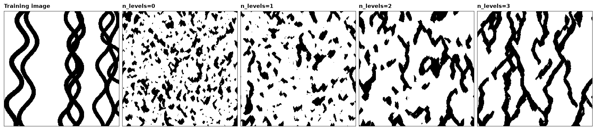
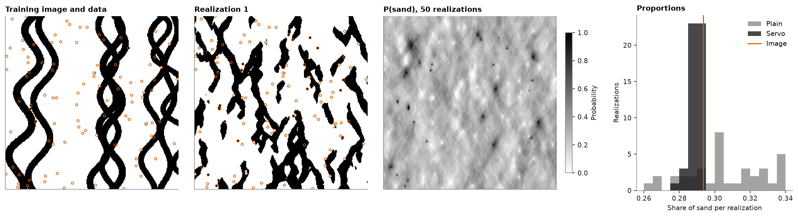
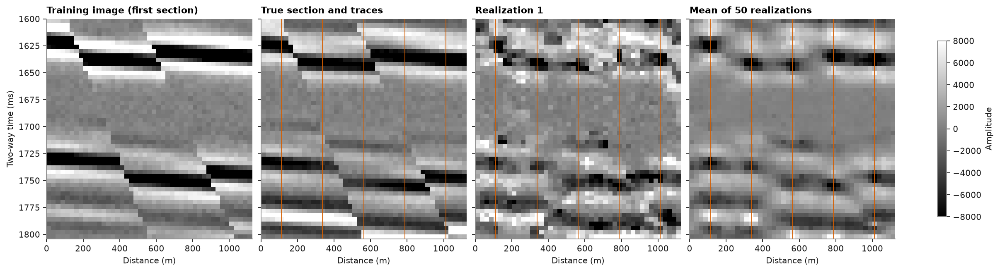
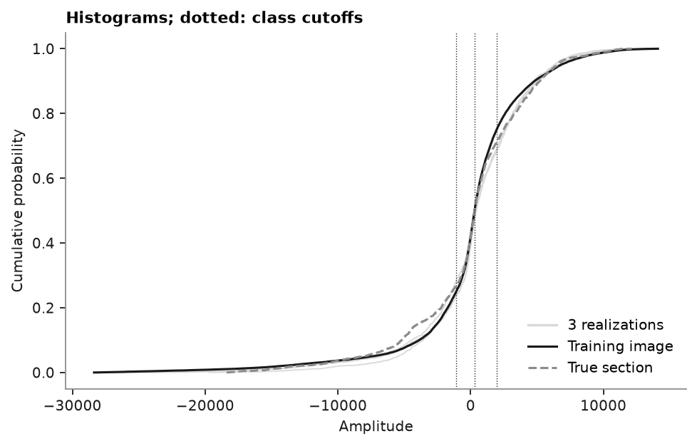

# SNESIM basics

SNESIM copies patterns instead of a variogram. It counts, once, each arrangement of categories the training image
holds around a cell, and a simulated cell draws its category from the counts of the arrangement around it. The
template it reads spans a few cells, too small to see a channel 100 cells long, so a multigrid simulates the coarse
structure first. Hard data fix their cells, a servosystem pulls the proportions toward a target, and a continuous
variable is cut into classes and then given values from the training image.

<details><summary>Python</summary>

```python
import boitata as bt
import matplotlib.pyplot as plt
import numpy as np
from common import GRAY, HIGHLIGHT, INK, LIGHT, save
from matplotlib.colors import ListedColormap

ti = bt.datasets.channel_training_image()
nx, ny = ti.count[:2]
image = ti.grid("facies")[0]
print(f"{nx} x {ny} cells, sand (code 1) in {image.mean():.1%} of them")
```

</details>

```text
250 x 250 cells, sand (code 1) in 29.4% of them
```

## The multigrid

The channels run along Y. The mean length of the runs of sand along Y measures how far a channel carries; across,
along X, it measures its width.

<details><summary>Python</summary>

```python
def runs(img, axis):
    """Mean length of the runs of code 1 along `axis` of a (y, x) image."""
    lines = img if axis == 1 else img.T
    lengths = [len(r) for line in lines for r in "".join(map(str, line.astype(int))).split("0") if r]
    return np.mean(lengths)


print(f"training image: sand runs {runs(image, 0):.1f} cells along Y, {runs(image, 1):.1f} across")
```

</details>

```text
training image: sand runs 22.3 cells along Y, 12.4 across
```

Twenty realizations for each number of coarse levels, from none to three, on a grid the size of the image. Each
level halves the spacing, so `n_levels=3` starts on every eighth cell. Half of a coarse template stays next to the
cell and half spreads over the level's spacing, so the template reaches farther and still sees the cells around it.

<details><summary>Python</summary>

```python
grid = bt.BlockModel((0, 0), (1, 1), (nx, ny))
realizations = {}
for levels in (0, 1, 2, 3):
    summary = bt.SNESIM(ti, "facies", n_levels=levels).simulate(grid, n=20, seed=7, keep=True)
    reals = summary.realizations.reshape(-1, ny, nx)
    realizations[levels] = reals[0]
    along = np.mean([runs(r, 0) for r in reals])
    across = np.mean([runs(r, 1) for r in reals])
    print(f"n_levels={levels}: sand {reals.mean():.1%}, runs {along:.1f} along Y, {across:.1f} across")
```

</details>

```text
n_levels=0: sand 24.8%, runs 7.3 along Y, 5.3 across
n_levels=1: sand 23.2%, runs 10.6 along Y, 7.3 across
n_levels=2: sand 27.5%, runs 17.1 along Y, 9.9 across
n_levels=3: sand 31.1%, runs 21.4 along Y, 11.4 across
```

Without levels the channels break into short pieces. Each level lengthens them, and three reach most of the
image's length. The coarse templates also shift the proportions: near its edges the image has no room for a
template 16 cells wide, and the cells far from the edges hold more sand, so the realizations end up with more sand
than the image. The servosystem below pulls it back.

<details><summary>Python</summary>

```python
codes = ListedColormap(["white", "black"])
fig, axes = plt.subplots(1, 5, figsize=(15, 3.6), layout="constrained")
panels = [(image, "Training image")] + [(realizations[k], f"n_levels={k}") for k in realizations]
for ax, (img, title) in zip(axes, panels):
    ax.imshow(img, origin="lower", cmap=codes, vmin=0, vmax=1, interpolation="nearest")
    ax.set_title(title)
    ax.set(xticks=[], yticks=[])
    for side in ax.spines.values():
        side.set(visible=True, color=INK, lw=0.6)
save(fig, "levels")
```

</details>



## Conditioning

Hard data fix the category of their cells in all realizations, and the patterns around them decide the rest. A
servosystem pulls each realization toward target proportions. 100 cells of the image drawn at random serve as hard
data, as if the image were the truth and these the wells:

<details><summary>Python</summary>

```python
rows = np.random.default_rng(0).choice(nx * ny, size=100, replace=False)
wells = grid.coords[rows]
facies = ti["facies"][rows].astype(int)
print(f"{facies.sum()} sand and {(facies == 0).sum()} shale data")
```

</details>

```text
28 sand and 72 shale data
```

Fifty realizations, once without targets and once with the image's proportions as targets. `servo` sets how hard
the servosystem pulls: a cell draws from its pattern probability plus `servo / (1 - servo)` times the gap between
the target and the share simulated so far. Where all matching patterns hold one category, the servosystem leaves
the cell alone.

<details><summary>Python</summary>

```python
sand = image.mean()
plain = bt.SNESIM(ti, "facies").fit(wells, facies)
steered = bt.SNESIM(ti, "facies", target_proportions=[1 - sand, sand], servo=0.8).fit(wells, facies)
summaries = {
    name: s.simulate(grid, n=50, seed=3, keep=[0]) for name, s in [("Plain", plain), ("Servo", steered)]
}
for name, summary in summaries.items():
    share = summary.proportions[:, 1]
    low, high = np.quantile(share, [0.05, 0.95])
    print(f"{name}: sand {share.mean():.1%} ({low:.1%} to {high:.1%}), image {sand:.1%}")
reproduced = all((s.realizations[:, rows] == facies).all() for s in summaries.values())
print(f"hard data reproduced in every realization: {reproduced}")
```

</details>

```text
Plain: sand 31.2% (26.0% to 35.4%), image 29.4%
Servo: sand 28.9% (28.5% to 29.3%), image 29.4%
hard data reproduced in every realization: True
```

The data steer the channels around them as well as their own cell: within 3 cells of a sand datum, sand is twice
as likely as on average, and near a shale datum half as likely. The image itself is more decided there, since the
data steer the patterns and the patterns still choose where each channel goes:

<details><summary>Python</summary>

```python
p_sand = grid.grid(summaries["Servo"].probabilities[:, 1])[0]
yy, xx = np.mgrid[:ny, :nx]
for code, label in ((1, "sand"), (0, "shale")):
    near = np.zeros((ny, nx), bool)
    for x, y in wells[facies == code, :2].astype(int):
        near |= (xx - x) ** 2 + (yy - y) ** 2 <= 9
    print(
        f"within 3 cells of {label} data: P(sand) {p_sand[near].mean():.2f}, image {image[near].mean():.2f}"
    )
```

</details>

```text
within 3 cells of sand data: P(sand) 0.55, image 0.88
within 3 cells of shale data: P(sand) 0.14, image 0.06
```

<details><summary>Python</summary>

```python
fig, axes = plt.subplots(1, 4, figsize=(15, 4), layout="constrained", width_ratios=[1, 1, 1, 0.9])
for ax, img, title in (
    (axes[0], image, "Training image and data"),
    (axes[1], grid.grid(summaries["Servo"].realizations[0])[0], "Realization 1"),
):
    ax.imshow(img, origin="lower", cmap=codes, vmin=0, vmax=1, interpolation="nearest")
    ax.scatter(
        *wells[:, :2].T, s=10, c=np.where(facies == 1, "black", "white"), edgecolors=HIGHLIGHT, linewidths=0.9
    )
    ax.set_title(title)
im = axes[2].imshow(p_sand, origin="lower", cmap="gray_r", vmin=0, vmax=1)
axes[2].set_title("P(sand), 50 realizations")
fig.colorbar(im, ax=axes[2], shrink=0.8, label="Probability")
for ax in axes[:3]:
    ax.set(xticks=[], yticks=[])
fig.get_layout_engine().set(wspace=0.08)
bins = np.linspace(0.26, 0.34, 17)
for name, color in (("Plain", GRAY), ("Servo", INK)):
    axes[3].hist(summaries[name].proportions[:, 1], bins, color=color, alpha=0.8, label=name)
axes[3].axvline(sand, color=HIGHLIGHT, lw=1.4, label="Image")
axes[3].set(xlabel="Share of sand per realization", ylabel="Realizations", title="Proportions")
axes[3].legend()
save(fig, "conditioning")
```

</details>



Without targets the realizations drift above the image's share of sand, as in the multigrid above; the servosystem
brings them back and narrows their spread. A strong servosystem costs some of the image's patterns, so keep `servo`
as low as the proportions allow.

## Continuous values

SNESIM counts patterns of categories, so it first cuts a continuous variable into a few classes. It simulates the
classes, then each cell takes a value from a cell of the training image in its class: of 32 drawn at random, the
one whose neighbors best match the values already simulated around it. Here SNESIM fills a seismic section between
five traces, with other sections of the same survey as the training image.

<details><summary>Python</summary>

```python
seismic = bt.datasets.seismic_cube()
nx, ny, nz = seismic.count
cube = seismic.grid("amplitude")[::-1]  # time down: row 0 at 1600 ms
print(f"{nx} x {ny} traces of {nz} samples, amplitude {cube.min():.0f} to {cube.max():.0f}")
```

</details>

```text
45 x 45 traces of 51 samples, amplitude -30956 to 14917
```

A section is 45 traces by 51 samples. One section holds few patterns, so the training image lays ten sections side
by side, every third one from the first. The section to simulate lies 13 sections past the last of them, and five
of its traces, 225 m apart, are the hard data. Cells are 25 m by 4 ms; SNESIM reads patterns cell by cell, so the
image and the section share that size.

<details><summary>Python</summary>

```python
image = np.hstack([cube[:, j, :] for j in range(0, 30, 3)])
section_truth = cube[:, 40, :]
continuous = bt.BlockModel((0, 1600), (25, 4), (image.shape[1], nz)).with_columns(
    {"amplitude": image.ravel()}
)
section = bt.BlockModel((0, 1600), (25, 4), (nx, nz))
traces = [4, 13, 22, 31, 40]
at_traces = np.zeros((nz, nx), bool)
at_traces[:, traces] = True
wells = section.coords[at_traces.ravel()]
values = section_truth[at_traces]
```

</details>

The default cutoffs are the image's quartiles: four classes keep the patterns frequent enough to count. Ten classes
give too many arrangements, and most cells fall back to the class proportions.

<details><summary>Python</summary>

```python
snesim = bt.SNESIM(continuous, "amplitude").fit(wells, values)
print("cutoffs:", np.round(np.quantile(image, [0.25, 0.5, 0.75])))
summary = snesim.simulate(section, n=50, seed=11, keep=range(3))
reals = summary.realizations.reshape(-1, nz, nx)
etype = section.grid(summary.mean)[0]
print(f"hard data reproduced: {np.allclose(reals[:, at_traces], values)}")
corr = [bt.compare(r.ravel(), section_truth.ravel())["correlation"] for r in reals]
print(
    f"correlation with the true section: realizations {np.mean(corr):.2f}, "
    f"mean of 50 {bt.compare(etype.ravel(), section_truth.ravel())['correlation']:.2f}"
)
```

</details>

```text
cutoffs: [-1089.   296.  1962.]
hard data reproduced: True
correlation with the true section: realizations 0.59, mean of 50 0.80
```

Each realization carries the main reflectors from trace to trace, but it is rougher than the seismic: the patterns
come from four classes, and within a class a value matches only its 8 nearest neighbors. The mean of 50 keeps what
the traces fix and smooths the rest.

<details><summary>Python</summary>

```python
extent = (0, nx * 25, 1600 + nz * 4, 1600)
style = {
    "cmap": "gray",
    "vmin": -8000,
    "vmax": 8000,
    "extent": extent,
    "aspect": "auto",
    "interpolation": "nearest",
}
fig, axes = plt.subplots(1, 4, figsize=(15, 4), layout="constrained", sharey=True)
panels = [
    (image[:, :nx], "Training image (first section)"),
    (section_truth, "True section and traces"),
    (reals[0], "Realization 1"),
    (etype, "Mean of 50 realizations"),
]
for ax, (img, title) in zip(axes, panels):
    im = ax.imshow(img, **style)
    ax.set(title=title, xlabel="Distance (m)")
for ax in axes[1:]:
    for t in traces:
        ax.axvline((t + 0.5) * 25, color=HIGHLIGHT, lw=0.8)
axes[0].set_ylabel("Two-way time (ms)")
fig.colorbar(im, ax=axes, shrink=0.8, label="Amplitude")
save(fig, "sections")
```

</details>



Each value comes from the image, yet the realizations follow the true section's histogram closer than the image's:
the five traces, a tenth of the section, carry its proportions of each class into the patterns around them.

<details><summary>Python</summary>

```python
fig, ax = plt.subplots(figsize=(6, 3.8), layout="constrained")
for r in summary.realizations:
    ax.plot(np.sort(r), np.linspace(0, 1, r.size), color=LIGHT, lw=0.8)
ax.plot([], [], color=LIGHT, label="3 realizations")
ax.plot(np.sort(image.ravel()), np.linspace(0, 1, image.size), color=INK, lw=1.4, label="Training image")
ax.plot(
    np.sort(section_truth.ravel()),
    np.linspace(0, 1, section_truth.size),
    color=GRAY,
    lw=1.4,
    ls="--",
    label="True section",
)
for q in np.quantile(image, [0.25, 0.5, 0.75]):
    ax.axvline(q, color=INK, lw=0.6, ls=":")
ax.set(xlabel="Amplitude", ylabel="Cumulative probability", title="Histograms; dotted: class cutoffs")
ax.legend(loc="lower right")
save(fig, "histograms")
```

</details>



Full script: [`example_10_11.py`](example_10_11.py)
