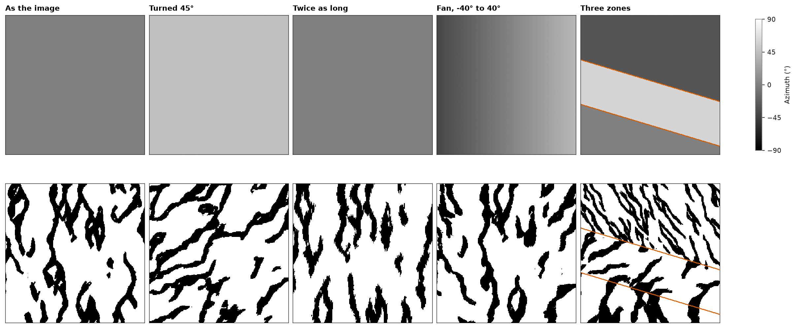
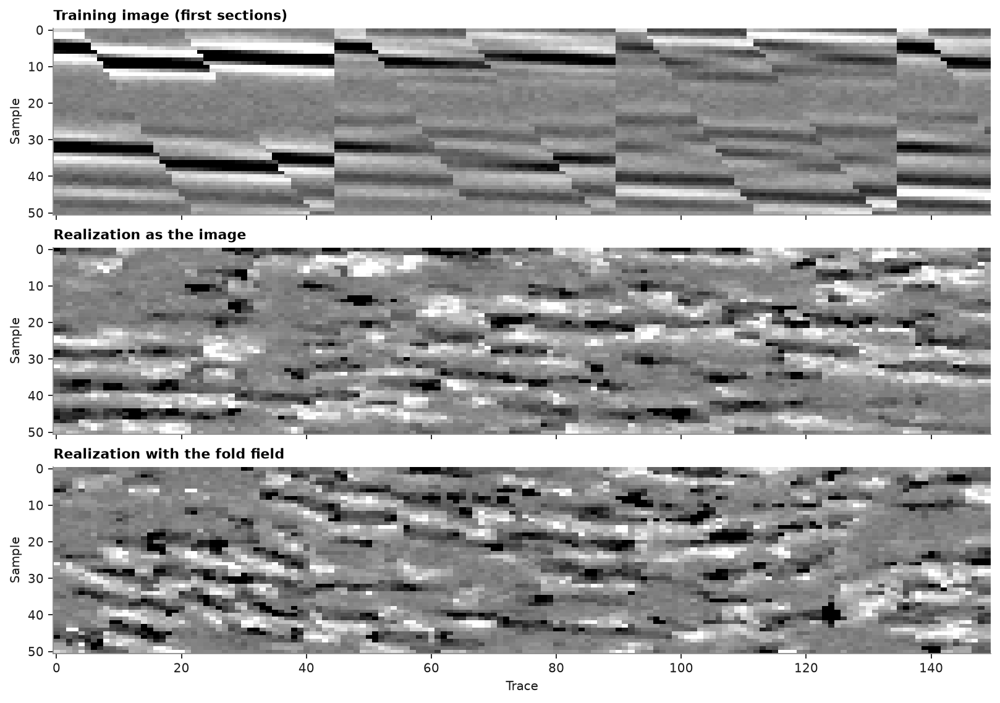
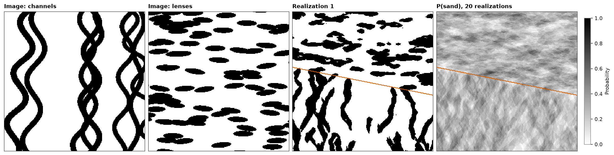
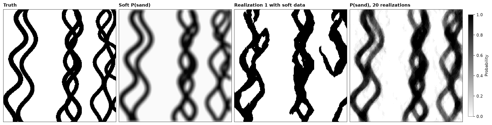

# Non-stationary SNESIM

A training image has one direction, one scale and one set of patterns, and a deposit rarely keeps any of them.
`anisotropy` turns and stretches the patterns cell by cell and leaves the image as it is. A training image per domain
changes the patterns themselves. Soft probabilities, one per category and cell, weigh against the patterns instead of
replacing them.

<details><summary>Python</summary>

```python
import boitata as bt
import matplotlib.pyplot as plt
import numpy as np
from common import HIGHLIGHT, INK, save
from matplotlib.colors import ListedColormap

ti = bt.datasets.channel_training_image()
n = ti.count[0]
grid = bt.BlockModel((0, 0), (1, 1), (n, n))
xy = grid.coords
x, y = grid.x, grid.y
```

</details>

## Rotation and affinity

At each cell, `bt.LocalAnisotropy` holds the azimuth that turns the image's north, the ratios that shrink its X
(semi-major) and Z (minor) axes against its Y axis, and a scale that grows all three. At azimuth 0 and scale 1 the
cells read the image as it is.

<details><summary>Python</summary>

```python
def anisotropy(azimuth, semi=1.0, scale=1.0):
    azimuth, semi, scale = (np.broadcast_to(np.asarray(v, float), x.shape) for v in (azimuth, semi, scale))
    angles = np.column_stack([azimuth, np.zeros_like(x), np.zeros_like(x)])
    return bt.LocalAnisotropy(xy, angles, np.column_stack([semi, np.ones_like(x)]), scales=scale)


zones = (y > 170 - 0.3 * x).astype(int) + (y > 90 - 0.3 * x)
fields = {
    "As the image": (0.0, 1.0, 1.0),
    "Turned 45°": (45.0, 1.0, 1.0),
    "Twice as long": (0.0, 0.5, 2.0),
    "Fan, -40° to 40°": (-40 + 80 * x / n, 1.0, 1.0),
    "Three zones": (
        np.choose(zones, [0, 60, -30]),
        np.choose(zones, [1.0, 1.0, 0.5]),
        np.choose(zones, [1.5, 1, 1]),
    ),
}
```

</details>

"Twice as long" doubles the scale and halves the X ratio, so the channels double in length and keep their width.
Two lines dipping east split three zones: the south enlarged 1.5 times, the middle turned 60°, the north turned
-30° with channels half as wide. SNESIM rounds angles to `angle_step` (10° by default), and each distinct rounded
transform gets search trees of its own.

<details><summary>Python</summary>

```python
def runs_along_y(img):
    lengths = [len(r) for col in img.T for r in "".join(map(str, col.astype(int))).split("0") if r]
    return np.mean(lengths)


snesim = bt.SNESIM(ti, "facies")
realizations = {}
for title, (azimuth, semi, scale) in fields.items():
    summary = snesim.simulate(grid, n=1, seed=3, keep=True, anisotropy=anisotropy(azimuth, semi, scale))
    realizations[title] = grid.grid(summary.realizations[0])[0]
    print(
        f"{title}: template classes {snesim.n_classes}, sand runs {runs_along_y(realizations[title]):.1f} cells along Y"
    )
```

</details>

```text
As the image: template classes 1, sand runs 21.4 cells along Y
Turned 45°: template classes 1, sand runs 13.8 cells along Y
Twice as long: template classes 1, sand runs 25.9 cells along Y
Fan, -40° to 40°: template classes 9, sand runs 20.3 cells along Y
Three zones: template classes 3, sand runs 12.7 cells along Y
```

<details><summary>Python</summary>

```python
codes = ListedColormap(["white", "black"])
fig, axes = plt.subplots(2, 5, figsize=(15, 6.4), layout="constrained")
for ax, (title, (azimuth, semi, scale)) in zip(axes[0], fields.items()):
    im = ax.imshow(
        grid.grid(np.broadcast_to(azimuth, x.shape))[0], origin="lower", cmap="gray", vmin=-90, vmax=90
    )
    ax.set_title(title)
for ax, (title, img) in zip(axes[1], realizations.items()):
    ax.imshow(img, origin="lower", cmap=codes, vmin=0, vmax=1, interpolation="nearest")
for ax in (axes[0, 4], axes[1, 4]):
    ax.contour(grid.grid(zones)[0], levels=[0.5, 1.5], colors=HIGHLIGHT, linewidths=1.2)
for ax in axes.flat:
    ax.set(xticks=[], yticks=[])
    for side in ax.spines.values():
        side.set(visible=True, color=INK, lw=0.6)
fig.colorbar(im, ax=axes[0], shrink=0.8, label="Azimuth (°)", ticks=[-90, -45, 0, 45, 90])
save(fig, "rotation")
```

</details>



Turned 45°, a channel crosses the Y runs on the diagonal, so they shorten. "Twice as long" lengthens the runs from 21
to 26 cells instead of doubling them: a doubled channel reaches past the grid template, and the coarse levels, which
keep their spacing, see only half as far into the stretched image.

The channels cross the zone boundaries without a seam: a cell near a boundary sees neighbors simulated under the
other zone's transform and continues them.

Continuous images turn the same way. The seismic sections of
[SNESIM basics](../../10-simulation/11-snesim-basics/README.md) have nearly flat reflectors; an azimuth rising from
-25° in the west to 25° in the east and back bends them into a fold. Here the cells are one trace by one sample, so
angles follow those units.

<details><summary>Python</summary>

```python
seismic = bt.datasets.seismic_cube()
nx, ny, nz = seismic.count
cube = seismic.grid("amplitude")[::-1]
image = np.hstack([cube[:, j, :] for j in range(0, 45, 3)])
sections = bt.BlockModel((0, 0), (1, 1), (image.shape[1], nz)).with_columns({"amplitude": image.ravel()})
width = 150
section = bt.BlockModel((0, 0), (1, 1), (width, nz))
along = section.x
fold = -25 * np.cos(np.pi * along / width)
field = bt.LocalAnisotropy(
    section.coords, np.column_stack([fold, 0 * fold, 0 * fold]), np.ones((along.size, 2))
)
continuous = bt.SNESIM(sections, "amplitude")
flat = continuous.simulate(section, n=1, seed=2, keep=True).realizations[0]
folded = continuous.simulate(section, n=1, seed=2, keep=True, anisotropy=field).realizations[0]
```

</details>

<details><summary>Python</summary>

```python
style = {"cmap": "gray", "vmin": -8000, "vmax": 8000, "aspect": "auto", "interpolation": "nearest"}
fig, axes = plt.subplots(3, 1, figsize=(10, 7), layout="constrained", sharex=True)
for ax, img, title in (
    (axes[0], image[:, :width], "Training image (first sections)"),
    (axes[1], section.grid(flat)[0], "Realization as the image"),
    (axes[2], section.grid(folded)[0], "Realization with the fold field"),
):
    ax.imshow(img, **style)
    ax.set(title=title, ylabel="Sample")
axes[2].set_xlabel("Trace")
save(fig, "fold")
```

</details>



## Several training images

If the geology changes across a model, one image cannot hold all its patterns. SNESIM takes a training image per
domain, `{domain: (model, column)}`, and `simulate` picks each cell's image from its domain. The images share one set
of codes, so a code means the same in each domain.

Objects build the second image: sand lenses about 36 by 10 cells, lying east-west, over 30 % of a grid the size of
the channel image.

<details><summary>Python</summary>

```python
channels = ti
lens = {"shape": "ellipsoid", "code": 1, "proportion": 0.3, "radii": (18, 5), "azimuth": (80, 100)}
lenses = bt.object_training_image(grid, [lens], seed=4)
print(f"sand: channels {channels['facies'].mean():.1%}, lenses {lenses['facies'].mean():.1%}")
```

</details>

```text
sand: channels 29.4%, lenses 30.2%
```

A line dipping east splits two domains: channels in the south, lenses in the north. Twenty realizations, with the
sand share of each domain against its image:

<details><summary>Python</summary>

```python
domains = np.where(y > 150 - 0.2 * x, "lenses", "channels")
snesim = bt.SNESIM({"channels": (channels, "facies"), "lenses": (lenses, "facies")})
summary = snesim.simulate(grid, n=20, seed=1, keep=[0], domains=domains)
for name, trained in (("channels", channels), ("lenses", lenses)):
    share = summary.probabilities[domains == name, 1].mean()
    print(f"{name}: realizations {share:.1%} sand, image {trained['facies'].mean():.1%}")
```

</details>

```text
channels: realizations 29.3% sand, image 29.4%
lenses: realizations 30.3% sand, image 30.2%
```

<details><summary>Python</summary>

```python
boundary = grid.grid(domains == "lenses")[0]
fig, axes = plt.subplots(1, 4, figsize=(15, 4), layout="constrained")
panels = (
    (channels["facies"], "Image: channels", codes),
    (lenses["facies"], "Image: lenses", codes),
    (summary.realizations[0], "Realization 1", codes),
    (summary.probabilities[:, 1], "P(sand), 20 realizations", "gray_r"),
)
for ax, (values, title, cmap) in zip(axes, panels):
    im = ax.imshow(grid.grid(values)[0], origin="lower", cmap=cmap, vmin=0, vmax=1, interpolation="nearest")
    ax.set(title=title, xticks=[], yticks=[])
    for side in ax.spines.values():
        side.set(visible=True, color=INK, lw=0.6)
for ax in axes[2:]:
    ax.contour(boundary, levels=[0.5], colors=HIGHLIGHT, linewidths=1.2)
fig.colorbar(im, ax=axes[3], shrink=0.8, label="Probability")
save(fig, "zones")
```

</details>



The boundary stays visible as a line. A cell next to it reads neighbors from both sides, which joins a channel to a
lens where they meet, but the change of pattern is abrupt. The images may differ in size and must share a kind: a
dict of continuous images works the same way, each domain drawing its values from its own image. Hard data,
`anisotropy` and `target_proportions` combine with domains as without them.

## Soft data

Hard data are rare; a probability of each category at each cell, from seismic or a geological interpretation, is
common. `soft` gives SNESIM one probability per category and cell, and SNESIM weighs them against the patterns of the
training image instead of copying them.

The image stands in for the truth again. Its sand indicator averaged over 11 by 11 cells plays the part of a
seismic probability of sand: it knows where the channels lie and misses their edges.

<details><summary>Python</summary>

```python
def smooth(img, width):
    kernel = np.ones(width) / width
    rows = np.apply_along_axis(np.convolve, 1, img, kernel, "same")
    return np.apply_along_axis(np.convolve, 0, rows, kernel, "same")


nx, ny = ti.count[:2]
image = ti.grid("facies")[0]
p_soft = np.clip(smooth(image, 11), 0.02, 0.98)
soft = np.column_stack([1 - p_soft.ravel(), p_soft.ravel()])
print(f"soft P(sand) from {p_soft.min():.2f} to {p_soft.max():.2f}, mean {p_soft.mean():.2f}")
```

</details>

```text
soft P(sand) from 0.02 to 0.98, mean 0.30
```

Twenty realizations without and with the soft probabilities. At each cell the probability read from the patterns,
`P_ti`, and the soft one combine by permanence of ratios, `P(c) ∝ P_ti(c) * P_soft(c) / P0(c)` with `P0` the
image's proportions. A soft probability equal to the image's share of sand changes nothing, and one near 0 or 1
overrules the patterns.

<details><summary>Python</summary>

```python
snesim = bt.SNESIM(ti, "facies")
summaries = {
    "patterns only": snesim.simulate(grid, n=20, seed=5, keep=[0]),
    "with soft data": snesim.simulate(grid, n=20, seed=5, keep=[0], soft=soft),
}
for name, summary in summaries.items():
    p_sand = summary.probabilities[:, 1]
    hits = (summary.realizations[0] == image.ravel()).mean()
    print(
        f"{name}: sand {summary.proportions[:, 1].mean():.1%}, realization 1 matches the image in {hits:.0%} of cells, "
        f"P(sand) against soft r = {np.corrcoef(p_sand, p_soft.ravel())[0, 1]:.2f}"
    )
```

</details>

```text
patterns only: sand 30.8%, realization 1 matches the image in 59% of cells, P(sand) against soft r = -0.07
with soft data: sand 32.3%, realization 1 matches the image in 86% of cells, P(sand) against soft r = 0.96
```

Without soft data a realization matches the truth no better than chance; with it, in four cells of five. The
channels sit where the soft probability is high and keep the image's width, but break where the patterns and the
soft map disagree, most often where two channels cross. The probability of 20 realizations is sharper than the soft
map it came from: the patterns turn a smooth 0.5 into either a channel or none.

<details><summary>Python</summary>

```python
fig, axes = plt.subplots(1, 4, figsize=(15, 4), layout="constrained")
panels = (
    (image, "Truth", codes),
    (p_soft, "Soft P(sand)", "gray_r"),
    (grid.grid(summaries["with soft data"].realizations[0])[0], "Realization 1 with soft data", codes),
    (grid.grid(summaries["with soft data"].probabilities[:, 1])[0], "P(sand), 20 realizations", "gray_r"),
)
for ax, (img, title, cmap) in zip(axes, panels):
    im = ax.imshow(img, origin="lower", cmap=cmap, vmin=0, vmax=1, interpolation="nearest")
    ax.set(title=title, xticks=[], yticks=[])
    for side in ax.spines.values():
        side.set(visible=True, color=INK, lw=0.6)
fig.colorbar(im, ax=axes[3], shrink=0.8, label="Probability")
save(fig, "soft")
```

</details>



Hard data override the soft probabilities at their cells, and both combine with `anisotropy`, domains and the
servosystem. [Image quilting](../../10-simulation/14-image-quilting/README.md) takes soft data too, as a cost instead
of a probability.

Full script: [`example_10_12.py`](example_10_12.py)
