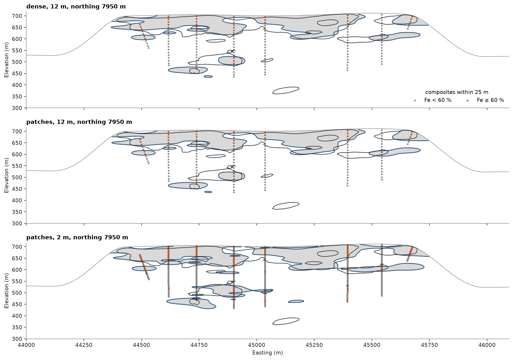

# large implicit models

one dense RBF system costs the cube of its sample count, which stops it at a few thousand samples. a partition of
unity splits the fit into overlapping local systems and blends them back into one field. here it takes the
Fe ≥ 60 % shell of [grade shells](../../11-geological-modeling/01-grade-shells/README.md) from the 12 m composites of the iron formation
plateau to all of its 2 m composites.

<details><summary>Python</summary>

```python
import time

import boitata as bt
import matplotlib.pyplot as plt
import numpy as np
from common import ACCENT, GRAY, HIGHLIGHT, LIGHT, save
```

</details>

<details><summary>Python</summary>

```python
data = bt.datasets.iron_formation_plateau()
holes = bt.Drillholes.from_tables(data)
composites = {length: holes.composite(length, ["FE_PCT"]).drop_null("FE_PCT") for length in (12.0, 2.0)}
for length, c in composites.items():
    high = (c["FE_PCT"] >= 60).sum()
    print(f"{length:4.0f} m: {len(c.coords):6,} composites, {high:5,} at or above 60 % Fe")
```

</details>

```text
  12 m:  3,437 composites,   658 at or above 60 % Fe
   2 m: 20,191 composites, 4,664 at or above 60 % Fe
```

`patch` picks the solver. `patch=0` solves one dense system; the default does so up to 2000 samples, and above
that an octree cuts the samples into cells, each with a ball around it of about 400 samples that overlaps its
neighbors' balls. each ball gets its own dense fit, and smooth weights that sum to 1 blend the fits into one field.
a fit honors every sample in its ball and its weight is zero outside it, so the field still honors every code.
the flat RBF of grade shells runs on the 12 m composites with both solvers, then on the 2 m composites, and each
field goes onto the block model and against the `high_grade.stl` solid.

<details><summary>Python</summary>

```python
flat = {"degree": 0, "rotation": (0, 0, 0), "ratios": (1, 0.2)}
runs = {
    "dense, 12 m": (bt.ImplicitModel("rbf", patch=0, **flat), composites[12.0]),
    "patches, 12 m": (bt.ImplicitModel("rbf", **flat), composites[12.0]),
    "patches, 2 m": (bt.ImplicitModel("rbf", **flat), composites[2.0]),
}
solid, blocks = data["high_grade"], data["block_model"]
in_solid = solid.contains(blocks.coords)
inside = {}
for name, (model, c) in runs.items():
    start = time.perf_counter()
    model.fit(c.coords, c["FE_PCT"], cutoff=60)
    seconds = time.perf_counter() - start
    code = np.where(c["FE_PCT"] >= 60, 1.0, -1.0)
    right = np.mean(np.sign(model.predict(c.coords)) == code)
    inside[name] = model.predict(blocks) > 0
    solver = model.report["solver"]
    if solver != "dense":
        solver = f"{model.report['patches']:,} patches"
    print(
        f"{name:>13}: {solver:>13}, {seconds:5.2f} s, {right:.1%} of composites on their side, "
        f"{blocks.volumes[inside[name]].sum() / 1e6:4.1f} Mm3, "
        f"covers {blocks.volumes[inside[name] & in_solid].sum() / blocks.volumes[in_solid].sum():.0%} of the solid, "
        f"{(inside[name] & ~in_solid).sum() / inside[name].sum():.0%} outside it"
    )
same = inside["dense, 12 m"] == inside["patches, 12 m"]
print(f"dense and patches put {same.mean():.2%} of the blocks on the same side")
```

</details>

```text
  dense, 12 m:         dense, 13.12 s, 100.0% of composites on their side, 67.4 Mm3, covers 65% of the solid, 29% outside it
patches, 12 m:   204 patches,  0.04 s, 100.0% of composites on their side, 67.4 Mm3, covers 65% of the solid, 29% outside it
 patches, 2 m: 1,198 patches,  0.23 s, 100.0% of composites on their side, 80.3 Mm3, covers 72% of the solid, 34% outside it
dense and patches put 99.90% of the blocks on the same side
```

on the 12 m composites the two solvers give the same volume and put all but one block in a thousand on the same
side, the dense one in seconds and the patches in hundredths of a second. both honor every code. six times as many
composites cost the patches a fraction of a second more, and the shell grows by a fifth. on the section of grade
shells, at true scale, with the trace of the solid in black and topography as a thin line:

<details><summary>Python</summary>

```python
xyz = composites[2.0].coords
code = np.where(composites[2.0]["FE_PCT"] >= 60, 1.0, -1.0)
northing = 25 * round(np.median(xyz[code > 0, 1]) / 25)
x, z = np.meshgrid(np.arange(44000, 46100, 5.0), np.arange(300, 720, 3.0))
section = np.c_[x.ravel(), np.full(x.size, northing), z.ravel()]
topography = data["topography"]
row = np.isclose(topography.y, northing, atol=12.5)
ground = np.interp(x[0], topography.x[row], topography["Z"][row])
plane = ((0, northing, 0), 90, 90)
fig, axes = plt.subplots(3, 1, figsize=(12, 8.5), layout="constrained", sharex=True)
for ax, (name, (model, c)) in zip(axes, runs.items(), strict=True):
    field = np.where(z <= ground, model.predict(section).reshape(x.shape), np.nan)
    ax.contourf(x, z, field, levels=[0, np.inf], colors=[LIGHT])
    ax.contour(x, z, field, levels=[0], colors=[ACCENT], linewidths=1.2)
    ax.plot(x[0], ground, color=GRAY, lw=0.8)
    high = c["FE_PCT"] >= 60
    style = {"plane": plane, "thickness": 50, "ax": ax}
    bt.plot.slab(c.coords[~high], s=4, color=GRAY, label="Fe < 60 %", meshes=solid, **style)
    bt.plot.slab(c.coords[high], s=4, color=HIGHLIGHT, label="Fe ≥ 60 %", **style)
    ax.set(title=f"{name}, northing {northing:.0f} m", xlim=(x[0, 0], x[0, -1]), ylim=(z[0, 0], z[-1, 0]))
    if ax is not axes[-1]:
        ax.set_xlabel("")
axes[0].legend(loc="lower right", title="composites within 25 m", ncol=2)
save(fig, "section")
```

</details>



the two 12 m fields draw the same contours. the 2 m composites keep the short high-grade runs down the holes that
12 m composites average below the cutoff, so the shell gains thin pods at depth. `patch` sets the samples per local
system: larger patches see more of the data around them and cost the cube of their size, smaller ones are cheaper
and lean more on the blend. on the 2 m composites:

<details><summary>Python</summary>

```python
reference = None
for patch in (1600, 400, 100):
    model = bt.ImplicitModel("rbf", patch=patch, **flat)
    start = time.perf_counter()
    model.fit(composites[2.0].coords, composites[2.0]["FE_PCT"], cutoff=60)
    seconds = time.perf_counter() - start
    side = model.predict(blocks) > 0
    reference = side if reference is None else reference
    print(
        f"patch={patch:<4}: {model.report['patches']:5,} patches, {seconds:5.2f} s, "
        f"{np.mean(side == reference):.2%} of the blocks on the side patch=1600 puts them"
    )
```

</details>

```text
patch=1600:   232 patches, 10.38 s, 100.00% of the blocks on the side patch=1600 puts them
patch=400 : 1,198 patches,  0.25 s, 99.51% of the blocks on the side patch=1600 puts them
patch=100 : 4,173 patches,  0.07 s, 99.00% of the blocks on the side patch=1600 puts them
```

the default of 400 stays within half a percent of the blocks of `patch=1600` at a small fraction of its time.
`report` says which solver ran and with how many patches. the 2000-sample switch counts constraint rows: each
sample and boundary pick is one, each plane two and each lineation one, so structural readings
([structural data](../../11-geological-modeling/03-structural-data/README.md)) go through patches too.

Full script: [`example_11_05.py`](example_11_05.py)
